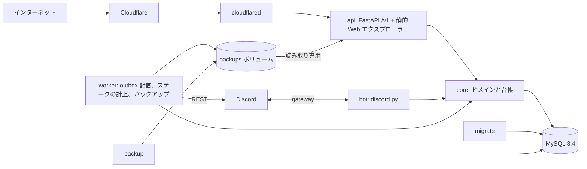

# RapidWire

RapidWire は Discord の中に存在する経済圏である。
Discord のサーバーはそれぞれ 1 つの通貨を発行でき、Discord のユーザーはそれぞれ自分の Discord ユーザー ID のもとで任意の数の通貨の残高を持つ。
ユーザーは送金し、許可額を承認し、請求を送り、連続複利の利息を得るためにステークし、複数経路の DEX に流動性を提供してスワップし、計量された RWC1 バイナリにコンパイルされる小さな Python 風の言語で書いたスマートコントラクトを配備する。
残高を変えるものはすべて実行と移動からなる 1 つの台帳に記録され、台帳は公開されている: 誰でも HTTP API と Web エクスプローラーを通じてすべての残高とすべての取引を読める。

ユーザーは Discord Bot のスラッシュコマンド、`/v1` HTTP API (直接、または `client/` の Python クライアント経由)、API が配信する Web エクスプローラーを通じて RapidWire を使う。
概念は [document/concepts.md](document/concepts.md) で説明し、[document/index.md](document/index.md) がすべての文書を一覧にしている。

## アーキテクチャ

RapidWire は 1 つの Python 3.12 パッケージ `rapidwire` であり、1 つのコンテナイメージにビルドされ、コンテナに与えるコマンドがその役割を選ぶ。
すべての役割は台帳に書き込む唯一のコードである同じドメインコアを使い、すべての役割は状態を 1 つの MySQL 8.4 データベースに保持する。



- データベースの外への副作用は、台帳のトランザクションの中では決して実行しない: Discord に届く必要のある操作 (請求の通知、コントラクトがキューに入れたメッセージやロールの変更) は自身のトランザクションで outbox の行を書き、worker がコミット済みの行を Discord REST API で配信する。
- API と worker は gateway 接続を持たず、サーバーの所有者、管理者、メンバーのロールは、Bot がデータベースに保持するギルド一覧 (`guild directory`) から知る。
- 公開するのは API だけで、Cloudflare Tunnel を通じて公開し、MySQL はホストの `127.0.0.1` でのみ待ち受ける。

### 構成要素

| 役割 | コマンド | 内容 |
| --- | --- | --- |
| `migrate` | `rapidwire migrate` | Alembic のマイグレーションを最新のリビジョンまで適用して終了する |
| `api` | `rapidwire api` | `/v1` HTTP API (OpenAPI 文書は `/openapi.json` と `/docs`) と、それ以外のすべてのパスで配信する静的 Web エクスプローラー |
| `bot` | `rapidwire bot` | Discord Bot: スラッシュコマンド、メンションによる API トークンの発行、ギルド一覧 |
| `worker` | `rapidwire worker` | outbox の配信、定期的なステークの計上、予定されたバックアップ (それぞれをデータベースのリースで保護する) |
| `backup` | `rapidwire backup` | 要求に応じてバックアップを 1 回取得し、`rapidwire backup verify` と `rapidwire backup restore` はダウンロードしたバックアップを検査する |
| - | `rapidwire verify-invariants` | 台帳の不変条件を検査して報告を出力する |

パッケージは層ごとに配置している:

| パッケージ | 内容 |
| --- | --- |
| `rapidwire/core` | 台帳、通貨、送金、許可額、請求、ステーク、プール、経路探索とスワップ、コントラクトの管理と呼び出し、ギルド一覧、照会と不変条件 |
| `rapidwire/db` | エンジン、テーブル定義、Alembic のマイグレーション |
| `rapidwire/contract` | コントラクトのコンパイラ、検証器、VM、ランタイム、模擬台帳、`rwc` ツール |
| `rapidwire/api` | FastAPI アプリケーションとそのルーター |
| `rapidwire/web` | 静的 Web エクスプローラーのページ |
| `rapidwire/bot` | Discord Bot とそのコマンドとビュー |
| `rapidwire/worker` | ジョブスケジューラと outbox の配信 |
| `rapidwire/backup` | ダンプ、エクスポート、保持、検証、復元 |
| `client/` | 単独でインストールできる Python クライアント `rapidwire_client` |

## Docker Compose によるクイックスタート

サーバーには Compose プラグイン 2.24 以降を備えた Docker Engine が amd64 上で必要であり、これはイメージが MySQL 8.4 クライアントを、amd64 のパッケージしか公開していない MySQL のリポジトリからインストールするためである。
運営者向けの完全な手引きは [document/operations.md](document/operations.md) である。

```
git clone https://github.com/RapidWire/RapidWire.git
cd RapidWire
cp .env.example .env
cp .env.mysql.example .env.mysql
cp .env.cloudflared.example .env.cloudflared
chmod 600 .env .env.mysql .env.cloudflared
```

3 つのファイルを記入する (これらは認証情報を保持し、git の管理対象外である):

| ファイル | 読むもの | 設定する値 |
| --- | --- | --- |
| `.env` | すべての RapidWire サービスと compose 自身 | `RAPIDWIRE_DB_PASSWORD` (8 文字以上)、`RAPIDWIRE_DISCORD_TOKEN` (Bot のトークン)、`RAPIDWIRE_OPERATOR_ACCOUNT_IDS` (バックアップのダウンロードを許可する Discord ユーザー ID) で、それ以外の設定にはすべて `.env.example` に記載した既定値がある |
| `.env.mysql` | `mysql` のみ | `MYSQL_ROOT_PASSWORD` |
| `.env.cloudflared` | `cloudflared` のみ | `TUNNEL_TOKEN` (Cloudflare Tunnel のトークン) |

- Discord の開発者ポータルで Bot の特権インテント Server Members Intent を有効にし、`bot` と `applications.commands` のスコープで Bot を招待する。
- Cloudflare のダッシュボードで、トンネルの公開ホスト名の転送先を `http://api:8000` にする。

続いてイメージをビルドし、スタックを起動する:

```
docker compose build
docker compose up -d
```

`docker compose up -d` は `mysql` を起動し、それが healthy になると `migrate` を実行し、マイグレーションが成功した後に `api`、`bot`、`worker`、`cloudflared` を起動する。
`RAPIDWIRE_DISCORD_TOKEN` がないと、`bot` と `worker` は `Invalid configuration: RAPIDWIRE_DISCORD_TOKEN is required for this command but is not set` という 1 行を出してコード 78 で終了し、Docker は間隔を延ばしながらそれらを再起動し続けるが、`.env` にトークンを設定した後は `docker compose up -d bot worker` がそれらをトークン付きで作り直す。
ビルドを宣言しているのは `migrate` サービスだけなので、`docker compose build` は共有の `rapidwire:local` イメージを 1 回だけビルドする。
更新は `git pull`、`docker compose build`、`docker compose up -d` であり、アプリケーションのサービスが起動する前に新しいマイグレーションが適用される。

worker は予定に従ってバックアップを取得し、`backup` サービスは `tools` プロファイルに属するため `docker compose up` では起動せず、`docker compose run --rm backup` が今すぐバックアップを 1 回取得する。
運営者は自分の API トークンを使い、エクスプローラーの `/operator.html` ページからバックアップをダウンロードする。

データベースとバックアップは名前付きボリューム `mysql-data` と `backups` にのみ存在する。
サーバー上で `docker compose down -v` (や `--volumes`、`docker volume rm`、`docker volume prune`、`docker system prune --volumes`) を決して実行しないこと: すべてのデータが復旧不能な形で失われる一方、`docker compose stop` と `-v` なしの `docker compose down` はボリュームを保持する。

## 開発

このプロジェクトは依存関係の閉包全体を `constraints.txt` に固定し、pip でインストールする:

```
python3.12 -m venv .venv
.venv/bin/pip install -c constraints.txt -e '.[dev]'
.venv/bin/playwright install chromium
```

editable インストールは `.venv/bin` に `rapidwire` と `rwc` のコマンドも提供する。
リント、型検査、テストは次のとおり:

```
.venv/bin/ruff check .
.venv/bin/ruff format --check .
.venv/bin/mypy
.venv/bin/pytest -q
```

- 単体テストは `tests/unit/` にあり、データベースを必要とせず、`.venv/bin/pytest -m "not integration"` は単体テストだけを実行する。
- `tests/integration/` の結合テストは、使い捨ての `mysql:8.4` コンテナを docker CLI で自ら起動し、終了後に削除するため、動作する docker は必要だが MySQL のインストールは不要であり、`RAPIDWIRE_TEST_DB_URL` を指定すると代わりに既存のサーバーを使うが、その中のテーブルはすべて削除されるため、データベース名は `_test` で終わらなければならない。
- Web エクスプローラーのブラウザテストは Chromium 上の Playwright を使い、Chromium がインストールされていなければスキップされるが、`RAPIDWIRE_TEST_REQUIRE_BROWSER=1` を設定するとスキップせずに失敗する。
- 設定は `RAPIDWIRE_` を接頭辞とする環境変数であり、環境または `.env` ファイルから読み込まれ、起動時に検証され、`.env.example` が各設定を説明している。
- 依存関係を追加したときは、`constraints.txt` をそのヘッダー行の説明どおりに再生成する。

## コントラクトのツールチェーン

コントラクトはコントラクト言語で書き、`rwc` で RWC1 バイナリにコンパイルし、メモリ上の模擬台帳で試し、Bot (`/contract set`) または API で勘定に登録する。
`document/contracts/samples/` で次のコマンドを実行すると、エディタ用のスタブを書き出し、サンプルをコンパイル、検査、逆アセンブル、実行する:

```
rwc stub .
rwc compile role_vending.py -o role_vending.rwc
rwc verify role_vending.rwc
rwc disasm role_vending.rwc
rwc run role_vending.py --state role_vending.state.json --function buy --pay RAPID:120000
```

[document/contracts/README.md](document/contracts/README.md) がコントラクトを紹介し、`document/contracts/samples/` には `rwc run` 用の状態ファイルを伴う完全なサンプルコントラクトがある。

## Python クライアント

`client/` のパッケージ `rapidwire_client` は `/v1` API の型付きクライアントで、同期版と非同期版があり、httpx だけに依存する:

```
pip install ./client
```

[client/README.md](client/README.md) がこれを説明している。

## ドキュメント

[document/index.md](document/index.md) がすべての文書を読者別 (Discord ユーザー、API とクライアントの開発者、コントラクトの作成者、運営者) に一覧にしている。
