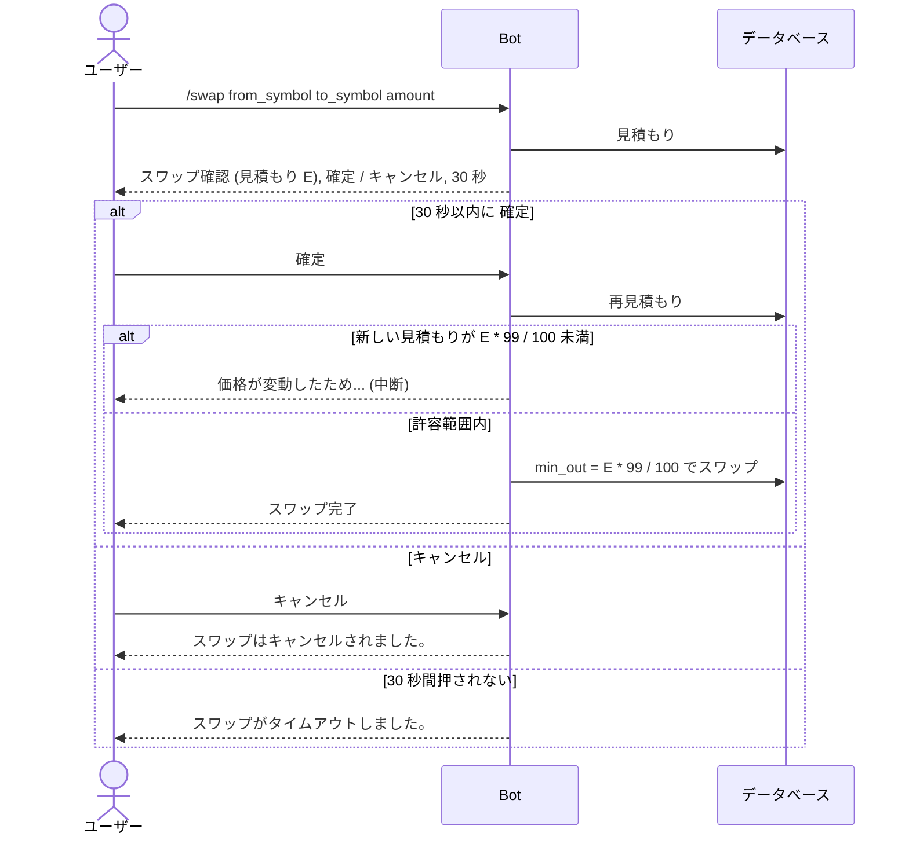
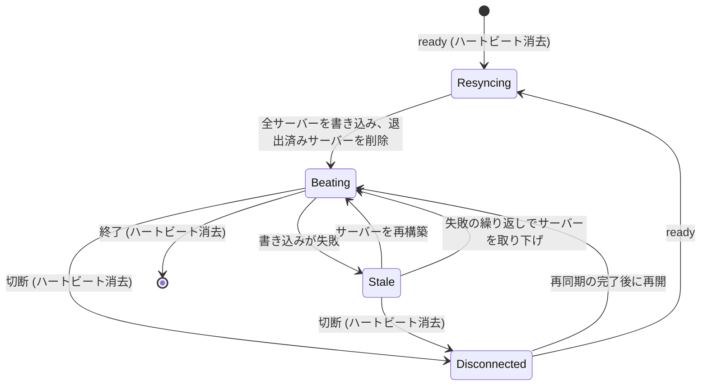

# RapidWire の Discord Bot

## 概要

Bot は RapidWire の台帳、DEX、コントラクトをスラッシュコマンドで Discord のユーザーに提供し、メンションされると API トークンを発行し、ゲートウェイ接続を持たないプロセスのために、各サーバーについて見えている内容をデータベースのギルド一覧 (`guild directory`) に反映する。
Bot が書く応答はすべて日本語であり、本書はその文面を表示されるとおりにコードスパンで引用する。

### Bot の起動

`rapidwire bot` は `RAPIDWIRE_DISCORD_TOKEN` で Discord に接続し、SIGINT または SIGTERM を受けるまで動作する。
これらのシグナルはゲートウェイセッションを正常に閉じる。
compose の配備ではこれは `bot` サービスであり、その停止猶予 30 秒が終了処理をまかなう。
Bot は起動のたびにコマンドツリーをグローバルに同期するため、コマンドを変更する配備に他の手順は要らない。
クライアントが新しいツリーを取得するまでの間、古いコマンドを実行すると `コマンドが更新されました。しばらくしてから再度お試しください。` と応答する。

`rapidwire bot --list-commands` は Discord にもデータベースにも接続せずに Bot とそのコマンドツリーを構築し、実行可能なコマンドを 1 行に 1 つずつ出力して終了する。
Discord のトークンもデータベースのパスワードも要らない。
各行は修飾付きのコマンド名に続けて、各パラメータを `name:type:required` または `name:type:optional` として並べたものであり、例えば `/transfer user:user:required amount:string:required symbol:string:optional` となる。

### ゲートウェイ intent

Bot は `guilds`、`members`、`guild_messages`、`dm_messages` の intent を要求し、それ以外は要求しない。

- `members` は特権 intent であり、Discord の開発者ポータルでアプリケーションに対して有効にしなければならない。ギルド一覧と Bot 自身の権限確認には、すべてのサーバーのすべてのメンバーとそのロールが必要であり、Bot は起動時にすべてのサーバーのメンバーを一括取得する。
- `message_content` は不要である。Discord は Bot をメンションしたメッセージと DM の内容をこの intent なしで届け、API トークンのメンションはそれ以外を読まない。

Bot が送るメッセージはユーザーをメンションすることがあるが、`@everyone`、`@here`、ロールは決してメンションしない。

### 設定

Bot は次の設定を環境変数または `.env` から読む。
その他の `RAPIDWIRE_` 設定は起動時に検証されるが、Bot は使わない。

| 設定 | 用途 |
| --- | --- |
| `RAPIDWIRE_DISCORD_TOKEN` | Bot のトークン。`rapidwire bot` では必須であり、`--list-commands` では不要 |
| `RAPIDWIRE_DB_HOST`, `RAPIDWIRE_DB_PORT`, `RAPIDWIRE_DB_NAME`, `RAPIDWIRE_DB_USER`, `RAPIDWIRE_DB_PASSWORD` | データベースへの接続 |
| `RAPIDWIRE_CONTRACT_MAX_SIZE` | `/contract set` が受け付けるバイナリの最大サイズ (バイト) |
| `RAPIDWIRE_GAS_CURRENCY_ID`, `RAPIDWIRE_GAS_PRICE`, `RAPIDWIRE_DEFAULT_GAS`, `RAPIDWIRE_MAX_GAS` | `/contract call` のガス。ガス代の通貨とガスの価格、ガス上限を指定しない呼び出しのガス上限、呼び出しが指定できる最大の上限 |
| `RAPIDWIRE_SWAP_CHUNK_COUNT`, `RAPIDWIRE_SWAP_MAX_ROUTES` | `/swap` とコントラクトのスワップの経路探索 |
| `RAPIDWIRE_LOG_LEVEL` | ログレベル |

## 共通の規則

### 金額

金額のパラメータは文字列であり、浮動小数点を使わずに最小単位へ正確に変換される。
小数点以下 3 桁までの 10 進数で、符号、指数、空白、桁区切り、先頭の 0 (小数点の前の単独の `0` を除く) を含まないものに限る (`12.5` と `0.001` は有効であり、`-1`、`1e3`、`1,000`、`01`、`.5` は無効である)。
金額は入力されたとおりに扱われる。
前後の空白は取り除かれないため、空白を含む金額は拒否される。
パラメータがゼロを受け付けると明記していない限り、金額は正でなければならない。
不正な金額には `金額は小数点以下 3 桁までの数値で指定してください (例: 12.5)。符号、指数表記、空白、先頭の余分な 0 は使えません。` と応答し、ゼロを受け付けない箇所でのゼロには `金額は 0.001 以上を指定してください。` と応答する。
金額は桁区切りとちょうど小数点以下 3 桁で表示され、その後にシンボルが続き、インラインコードとして示される (`1,000.000 RAPID`)。

### 通貨シンボル

シンボルのパラメータは、大文字と小文字の違いと前後の空白を無視して、削除されていない通貨と照合される。
省略可能なシンボルのパラメータを省略すると、コマンドを実行したサーバーの通貨を意味する。
DM の中、または通貨を持たないサーバーでは、そのようなコマンドはシンボルの指定を求める。
未知のシンボルには、見つからなかったシンボルを示して応答する。

### オートコンプリート

- 既存の通貨を指定するすべてのパラメータ (`/currency create` の新しいシンボルを除く各シンボルのパラメータと、`/contract call` の `currency`) は、入力した文字列をシンボルに含む削除されていない通貨を、その文字列で始まるものを先にして、`SYMBOL (name)` の選択肢として提示する。
- `/history` の `execution_type` は、値または日本語のラベルに入力した文字列を含む実行の種類を提示する。
- `/contract call` の `function` と `args` は、選んだユーザーのコントラクトの公開関数と、選んだ関数の引数のテンプレートを提示する ([コントラクト呼び出しの引数](#コントラクト呼び出しの引数) を参照)。
- `/lp` コマンドの `fee_tier` は `1%`、`0.5%`、`0.1%` の固定の選択肢である。
- `/claim list` の `role` は `請求者として` と `支払者として` の固定の選択肢である。

Discord が表示する選択肢は最大 25 個である。
検索が失敗するか時間がかかりすぎると選択肢は提示されないため、空の一覧はデータベースが応答しなかったことを意味する場合もある。

### ページ送り

ページ分けされた一覧は 1 ページ 15 件を表示するが、`/history` だけは 1 ページ 10 件である。
`page` は 1 から始まり、タイトルの末尾は `(ページ <page>/<pages>)` となる。
1 未満のページや最後のページより後のページには `指定されたページ (<page>) は存在しません。全 <pages> ページです。` と応答する。
ページ送りでたどれるのは一覧の先頭 10,000 件までであり、それより後のページには条件を絞り込むよう求める。

### 応答とエラー

すべてのコマンドはただちに Discord の考え中の表示を出し、その後に埋め込み (embed) で応答する。
成功は緑、情報は青、プールとステークは紫、失敗は `エラー` という題の赤である。
応答はチャンネルに公開されるが、`/swap` だけは見積もりと結果を実行者だけが見られる。
エラーは、それが置き換える応答と同じ公開範囲を持つ。
コマンドの実行前に起きたエラー (DM で使われた `/discord-permission` や、変換できなかった引数など) は実行者だけに表示される。

エラーメッセージは Bot がエラーのコードから作り、例外の文面を繰り返すことはない。
コマンドは自分の場合に合わせてコードの文言を変えることがあり、例えば自分自身への送金には `自分自身には送金できません。` と応答する。
失敗した操作が実行として記録された場合、エラーの埋め込みにはその `実行ID` が付く。
失敗したコントラクトの実行にはさらに、失敗の種類 (`種別`)、失敗した呼び出しの理由 (`理由`)、ガス上限に対する使用ガスを桁区切りで (`使用ガス`) とそのガス代の通貨での費用 (`ガス代`)、失敗した入れ子の実行の原因 (`原因`)、コントラクトの revert の文面または拒否されたバイナリについての検証器の説明 (`詳細`) が付く。
予期しない失敗には `予期せぬエラーが発生しました。時間をおいて再度お試しください。` と応答し、スタックトレースとともにログに記録する。
成功した操作の応答を Discord が拒否した場合、Bot はもう一度だけ送り (ボタンの応答の場合は押した人だけに)、それも失敗すればログに記録する。
操作を失敗として報告することはない。

### 冪等性

コマンドが行う書き込みはすべて冪等キー `discord:<interaction id>` を使うため、1 回のスラッシュコマンドや 1 回のボタン押下は、Discord が再送しても高々 1 回しか適用されない。
請求の通知のボタン `承認` と `拒否` は代わりにメッセージとボタンで操作をキーとし、スワップの確認は `/swap` のインタラクションでキーとするため、これらを再び押すと最初の結果が再現される。
それ以外のボタン押下はすべて新しい操作である。

### 権限

Bot は、誰がサーバーを所有し誰が管理者であるかを、そのサーバーについての自身のゲートウェイからの見え方で判断する。
所有者はサーバーの所有者であり、管理者は管理者権限を持つロールを持つメンバーである (所有者は暗黙には管理者ではない)。
`/currency mint` のようにサーバーの通貨を対象とするコマンドは、そのサーバーの中でのみ動作する。

## 勘定のコマンド

### /balance

ユーザーの残高を、通貨ごとに 1 つのフィールド `<name> (<SYMBOL>)` として 1 ページ 15 件で表示し、題は `<user>の保有資産` である。

| パラメータ | 型 | 必須 | 説明 |
| --- | --- | --- | --- |
| `user` | user | いいえ | 残高を表示するユーザー。省略すると実行者 |
| `page` | integer | いいえ | ページ (1 から) |

残高を持たないユーザーには `<user>は資産を保有していません。` と応答する。

### /transfer

実行者からユーザーへ、ある通貨の金額を送る。

| パラメータ | 型 | 必須 | 説明 |
| --- | --- | --- | --- |
| `user` | user | はい | 受取人 |
| `amount` | string | はい | 金額 |
| `symbol` | string | いいえ | 通貨 (オートコンプリートあり)。省略するとサーバーの通貨 |

応答は `転送ID` を付けた `送金完了` である。
自分自身への送金には `自分自身には送金できません。` と応答し、ゼロまたは負の金額には `送金額は0より大きい必要があります。` と応答する。

### /transfer_from

別のユーザーが実行者に与えた許可額の範囲で、そのユーザーの残高から金額を送る ([/approve set](#approve-set) を参照)。

| パラメータ | 型 | 必須 | 説明 |
| --- | --- | --- | --- |
| `source` | user | はい | 残高の持ち主 |
| `destination` | user | はい | 受取人 |
| `amount` | string | はい | 金額。残りの許可額以下 |
| `symbol` | string | いいえ | 通貨 (オートコンプリートあり)。省略するとサーバーの通貨 |

送金元は実行者とも送金先とも異なっていなければならず、ゼロまたは負の金額には `送金額は0より大きい必要があります。` と応答する。
応答は `転送ID` と `実行ID` を付けた `代理送金完了` である。

### /history

移動を新しい順に 1 ページ 10 件で検索するか、1 件の移動を詳細に表示する。

| パラメータ | 型 | 必須 | 説明 |
| --- | --- | --- | --- |
| `transfer_id` | integer | いいえ | この移動を詳細に表示し、他の条件はすべて無視する |
| `user` | user | いいえ | このユーザーから、またはこのユーザーへの移動 |
| `source` | user | いいえ | このユーザーからの移動 |
| `destination` | user | いいえ | このユーザーへの移動 |
| `currency_symbol` | string | いいえ | この通貨の移動 (オートコンプリートあり) |
| `start_date` | string | いいえ | 最初の日。日本標準時の `YYYY-MM-DD` |
| `end_date` | string | いいえ | 最後の日。日本標準時の `YYYY-MM-DD` で、この日を含む |
| `min_amount` | string | いいえ | 最小の金額。ゼロを受け付ける |
| `max_amount` | string | いいえ | 最大の金額。ゼロを受け付け、`min_amount` を下回ってはならない |
| `execution_type` | string | いいえ | この種類の実行による移動 (オートコンプリートあり) |
| `contract_function` | string | いいえ | この名前のコントラクト関数の呼び出しによる移動。64 文字以内 |
| `page` | integer | いいえ | ページ (1 から) |

空白だけの文字列の条件は指定されていないものとみなす。
日付とその他の文字列の条件は前後の空白を無視するが、金額の条件は他の金額と同じく入力されたとおりに扱われる。
未知の `currency_symbol` は空の結果ではなくエラーとなり、`execution_type` はその選択肢のいずれかでなければならない。
`user`、`source`、`destination` のいずれもない場合、検索は実行者の移動が対象となる。
一覧の各項目は、出金、入金、第三者間のいずれかを示す印、移動の ID、相対時刻、金額、相手側を表示する。
利息とガス代の移動には `利息` と `ガス代` のラベルが付き、システム勘定 (発行勘定と保管勘定) は `システム` と表示される。
詳細表示ではさらに、時刻、両側、実行の ID、種類、状態、コントラクト関数を表示する。

## 通貨のコマンド

サーバーが持てる通貨は最大 1 つであり、それを作成するのはサーバーの所有者だけである。
管理コマンド (`mint`、`renounce`、`delete`、`request-interest-change`、`apply-interest-change`) はコマンドを実行したサーバーの通貨を対象とし、所有者と、管理の委任が有効な間はそのサーバーの管理者が使える。
それ以外の人には `この操作を行えるのは、サーバーの所有者と、管理の委任が有効な場合の管理者だけです。` と応答する。
利率は 1 時間あたりの百分率で 0 から 100 まで、小数点以下 4 桁まで指定でき (`0.5`、`1.25`)、百万分率で正確に保存される。

### /currency create

サーバーの通貨を作成し、初期供給量を実行者に与える。

| パラメータ | 型 | 必須 | 説明 |
| --- | --- | --- | --- |
| `name` | string | はい | 名前。24 文字以内で、英字で始まり英字または数字で終わる。記号は `_` だけを使え、連続させず、5 回まで |
| `symbol` | string | はい | 新しいシンボル (大文字に変換される)。`A` から `Z` と `-` の 8 文字以内で、`-` は連続させず、2 回までで、両端には置けない |
| `supply` | string | はい | 初期供給量。ゼロを受け付ける |
| `hourly_interest_rate` | string | いいえ | ステークの利率 (1 時間あたりの百分率)。省略すると 0 |

作成できるのはサーバーの所有者だけであり (`通貨を発行できるのはサーバーの所有者だけです。`)、既に通貨を持つサーバー、または既に使われているシンボルには `このサーバーには既に通貨が存在するか、そのシンボルは使用済みです。` と応答する。
応答は、供給量、利率、初期供給の移動 ID、実行 ID を付けた `通貨発行成功` である。

### /currency info

通貨を表示する。
その ID (サーバーの ID)、作成者、総供給量、ステークの利率、予約中の利率変更とその予約時刻および適用可能になる時刻、Mint と利率変更が放棄されているか、管理が委任されているか、供給量が上限に達したため利息が止まっているか、そして削除の要請中であればそれを確定できる期間を表示する。

| パラメータ | 型 | 必須 | 説明 |
| --- | --- | --- | --- |
| `symbol` | string | いいえ | 通貨 (オートコンプリートあり)。省略するとサーバーの通貨 |

### /currency mint

サーバーの通貨を追加で実行者に発行する。

| パラメータ | 型 | 必須 | 説明 |
| --- | --- | --- | --- |
| `amount` | string | はい | 発行する金額 |

Mint 放棄済みの通貨には `この通貨のMint機能は放棄されています。` と応答する。

### /currency burn

実行者が持つサーバーの通貨の残高の一部を焼却する。
その通貨を保有する人は誰でも焼却できる。

| パラメータ | 型 | 必須 | 説明 |
| --- | --- | --- | --- |
| `amount` | string | はい | 焼却する金額 |

### /currency renounce

サーバーの通貨の Mint と利率変更を恒久的に放棄する。

パラメータはない。

### /currency delete

サーバーの通貨を 2 段階で削除する。
1 回目の実行で削除を要請し、要請の 7 日後から 10 日後までの間の 2 回目の実行でそれを確定する。

パラメータはない。

7 日より前の 2 回目の実行には、確定できるようになる時刻を示して応答する。
要請から 10 日を超えた後の実行では要請が失効している。
その実行は失敗した確定として記録され、要請は消去され、応答は `削除要請から10日以上が経過したため、この削除要請は無効になりました。` とそれに続く行 `再度削除を要請してください。` である。
その次の実行で再び削除を要請する。
`/currency info` は失効した要請を表示しない。
確定すると、その通貨のすべての残高とステークを焼却し、そのプールを解散し、その未払いの請求を取り消し、その許可額を削除する。
応答 `通貨削除完了` はそれぞれの件数を示す。

### /currency request-interest-change

サーバーの通貨に新しいステークの利率を予約する。
これは 7 日後に適用できる。

| パラメータ | 型 | 必須 | 説明 |
| --- | --- | --- | --- |
| `rate` | string | はい | 新しい利率 (1 時間あたりの百分率) |

応答 `利率変更予約完了` は新しい利率を小数点以下 4 桁の `<rate>%/hour` として示し、適用できるようになる時刻を示す。
予約できる変更は 1 つだけであり (`既に予約されている利率変更があります。適用してから再度予約してください。`)、Mint 放棄済みの通貨は拒否する。

### /currency apply-interest-change

予約中の利率変更を、その 7 日が経過した後に適用する。
まずその通貨のすべてのステークを旧利率で計上し、その後に新しい利率が有効になる。

パラメータはない。

応答 `利率変更適用完了` は新しい利率を `<rate>%/hour` として示し、旧利率で計上したステークの数を示す。
7 日が経過する前は変更を適用できるようになる時刻を示して応答し、予約中の変更がなければ `予約されている利率変更はありません。` と応答する。

### /currency delegation enable

サーバーの管理者が通貨を管理できるようにする。
実行できるのは所有者だけである (`管理の委任を切り替えられるのはサーバーの所有者だけです。`)。

パラメータはない。

### /currency delegation disable

所有者を再び通貨の唯一の管理者にする。
実行できるのは所有者だけである。

パラメータはない。

## ステークのコマンド

ステークした金額には通貨の 1 時間あたりの利率で利息が付き、`worker` が定期的に計上する。
計上によって通貨の供給量が上限に達すると、その後の焼却で供給量が上限を下回っても、その通貨は以後利息を払わない。
引き出しは引き続き動作し、利息が再び付くのは通貨を削除した後に作り直した場合だけである。

### /stake deposit

実行者の残高から実行者のステークへ金額を移す。

| パラメータ | 型 | 必須 | 説明 |
| --- | --- | --- | --- |
| `amount` | string | はい | ステークする金額 |
| `symbol` | string | いいえ | 通貨 (オートコンプリートあり)。省略するとサーバーの通貨 |

応答は金額と新しいステークの合計を示す。

### /stake withdraw

実行者のステークから残高へ金額を戻す。

| パラメータ | 型 | 必須 | 説明 |
| --- | --- | --- | --- |
| `amount` | string | はい | 引き出す金額 |
| `symbol` | string | いいえ | 通貨 (オートコンプリートあり)。省略するとサーバーの通貨 |

### /stake info

実行者のステークを 1 ページ 15 件で表示する。
それぞれについて、現時点までに計上される利息を含む金額、現在の利率、最後に計上した時刻を表示する。

| パラメータ | 型 | 必須 | 説明 |
| --- | --- | --- | --- |
| `page` | integer | いいえ | ページ (1 から) |

## 許可額のコマンド

### /approve set

ユーザーが `/transfer_from` で実行者の残高から送れる通貨の量を設定し、以前の許可額を置き換える。

| パラメータ | 型 | 必須 | 説明 |
| --- | --- | --- | --- |
| `user` | user | はい | 使用を許可するユーザー。実行者以外 |
| `amount` | string | はい | 許可額。ゼロで取り消す |
| `symbol` | string | いいえ | 通貨 (オートコンプリートあり)。省略するとサーバーの通貨 |

負の金額には `許可額は0以上である必要があります。` と応答する。

### /approve info

実行者があるユーザーに与えている現在の許可額を表示する。

| パラメータ | 型 | 必須 | 説明 |
| --- | --- | --- | --- |
| `user` | user | はい | 使用を許可されたユーザー |
| `symbol` | string | いいえ | 通貨 (オートコンプリートあり)。省略するとサーバーの通貨 |

## コントラクトのコマンド

各勘定が持てるコントラクトは最大 1 つであり、それはコンパイル済みの RWC1 バイナリである (`document/contracts/` を参照)。
管理コマンドは実行者自身のコントラクトを対象とする。
ロックはそれが終わるまでコントラクトの更新、停止、再開、削除を禁じ、ロック中も呼び出しは動作する。

### /contract set

添付したバイナリを実行者のコントラクトの次の版として登録し、削除済みのコントラクトであれば復活させる。

| パラメータ | 型 | 必須 | 説明 |
| --- | --- | --- | --- |
| `binary` | attachment | はい | コンパイル済みのバイナリ (`.rwc`)。1 バイトから `RAPIDWIRE_CONTRACT_MAX_SIZE` まで |
| `lock_hours` | integer | いいえ | 登録後にコントラクトをこの時間数だけロックする。1 から 876,000 まで |

添付ファイルの申告サイズはダウンロードの前に確認される。
拒否されたバイナリについての検証器の説明は `詳細` に表示される。
応答は版、状態、サイズ、SHA-256、ロック、公開関数、実行 ID を表示する。
登録に成功した後でロックに失敗した場合、登録はそのまま残り、ロックのフィールドに `ロックできませんでした:` とそれに続く理由として報告される。
理由の文言は [/contract lock](#contract-lock) と同じであり、そこでの予期しない失敗は `` ロックできませんでした: 予期せぬエラーが発生しました。`/contract lock` で再度お試しください。 `` となる。

### /contract get

現在の版のバイナリをファイル `contract-<account id>-v<version>.rwc` として、その版、状態、サイズ、SHA-256、ロック、公開関数とともに返す。

| パラメータ | 型 | 必須 | 説明 |
| --- | --- | --- | --- |
| `user` | user | いいえ | コントラクトの持ち主。省略すると実行者 |

### /contract call

ユーザーのコントラクトの公開関数を呼び出す。

| パラメータ | 型 | 必須 | 説明 |
| --- | --- | --- | --- |
| `user` | user | はい | コントラクトの持ち主 |
| `function` | string | はい | 公開関数 (コントラクトの関数からのオートコンプリートあり) |
| `args` | string | いいえ | 下記の書式の引数 (関数のシグネチャからのオートコンプリートあり)。省略すると引数なし |
| `pay` | string | いいえ | 呼び出しに添付してコントラクトに支払う金額。自分のコントラクトの呼び出しでは使えない |
| `currency` | string | いいえ | `pay` の通貨 (オートコンプリートあり)。省略するとサーバーの通貨で、`pay` と一緒にのみ指定できる |
| `gas` | integer | いいえ | ガス上限。1 から `RAPIDWIRE_MAX_GAS` まで。省略すると `RAPIDWIRE_DEFAULT_GAS` |

使用したガスは実行者にガス代の通貨で課金される。
応答 `コントラクト実行完了` は関数のシグネチャ、型付きの戻り値、ガス上限に対する使用ガス、ガス代、代金、実行 ID を表示する。
revert したコントラクトには、その revert の文面を付けて `取引はコントラクトによってキャンセルされました。` と応答する。
その他の失敗はガス切れなどの種類を示し、失敗したすべての呼び出しは使用ガスとその費用を表示する。
失敗した入れ子の呼び出しはその理由を示し、例えば添付する額を支払えない場合は `ガス代の前払いまたは添付する額の残高が不足しています` となる。

### コントラクト呼び出しの引数

公開関数はスカラーのパラメータだけを取る。
`args` は関数のパラメータの順に引数をカンマ区切りで並べる。
二重引用符の中のカンマだけは区切りにならず、閉じていない二重引用符は拒否される (`引数を読み取れません: 閉じていない二重引用符 (") があります。`)。
各引数は宣言された型に従って読まれる。

| 型 | 書式 |
| --- | --- |
| `int` | 省略可能なマイナス記号を持ち先頭の 0 を含まない 10 進整数 (`100`、`-5`)。コントラクトの整数の範囲内 |
| `str` | 二重引用符で囲んだ JSON 文字列 (`"hello, world"`。`\"` や `\n` などのエスケープを使える)。関数の唯一のパラメータが `str` の場合、二重引用符で始まらない文字列はそのまま文字列として扱われる |
| `bool` | `true` または `false`。大文字と小文字は問わない |
| `Account` | ユーザーのメンション (`<@123>`) または勘定の ID |
| `Currency` | 通貨シンボル (大文字と小文字は問わない) または通貨の ID |

例えば `100, "text", <@123456789012345678>, RAPID` は `f(int, str, Account, Currency)` に適合する。
適合しない引数は、呼び出しの前にその位置と型を示して拒否される。
例えば `引数 2 (str): 文字列は "..." のように二重引用符で囲んでください。カンマを含む文字列も引用符の中に書けます。` であり、引数の数が誤っていればシグネチャを示す。

`args` の入力中、最初のオートコンプリートの選択肢は、それまでに入力した引数に続けて、残りの各パラメータの `<type>` プレースホルダーを示す。
`bool` または `Currency` のパラメータでは、続く選択肢が入力中の引数を `true` と `false`、または削除されていない通貨のシンボルで補完する。
何も入力していないときの選択肢は `<int>, <Account>` のようなプレースホルダーのテンプレート全体であるが、唯一のパラメータが `str` の関数は例外である。
その関数ではテンプレートがそのまま文字列として扱われてしまうためである。
テンプレートを変更せずに送ると `` `<template>` は引数の書式の例です。それぞれを実際の値に置き換えてください。 `` で拒否される。

### /contract info

コントラクトの状態、現在の版と版の数、サイズ、SHA-256、ロック、各上限に対するストレージの使用量、公開関数、最終更新を表示する。

| パラメータ | 型 | 必須 | 説明 |
| --- | --- | --- | --- |
| `user` | user | いいえ | コントラクトの持ち主。省略すると実行者 |

### /contract lock

実行者のコントラクトを、現在から指定した時間数後までロックする。
既存のロックは延長しかできず、停止中のコントラクトはロックできない。

| パラメータ | 型 | 必須 | 説明 |
| --- | --- | --- | --- |
| `hours` | integer | はい | 現在からの時間数。1 から 876,000 まで |

停止中のコントラクトのロックには `一時停止中のコントラクトはロックできません。先に再開してください。` と応答する。
現在のロックより後に終わらないロックには `ロック期限は延長のみできます。現在のロック期限 (<time>) より後になる期間を指定してください。` と応答し、現在のロックを読み取れない場合は時刻を省く。

### /contract pause

実行者の有効でロックされていないコントラクトを停止し、再開するまでその呼び出しを失敗させる。

パラメータはない。

### /contract resume

実行者の停止中でロックされていないコントラクトを再開する。

パラメータはない。

### /contract delete

実行者のロックされていないコントラクトを削除し、そのストレージを消去する。
版は保持され、`/contract set` で復活する。

パラメータはない。

## 請求のコマンド

請求は、ユーザー (支払者) に対し、サーバーの通貨のある金額を実行者 (請求者) に支払うよう求める。

### /claim create

コマンドを実行したサーバーの通貨で請求を作成する。

| パラメータ | 型 | 必須 | 説明 |
| --- | --- | --- | --- |
| `user` | user | はい | 支払者。実行者以外 |
| `amount` | string | はい | 金額 |
| `description` | string | いいえ | 50 文字以内の説明 |

応答 `請求作成完了` は請求 ID を表示する。
支払者が実行者からの通知を許可している場合、支払者は DM も受け取る ([請求の通知](#請求の通知) を参照)。

### /claim list

実行者が請求者または支払者である請求を 1 ページ 15 件で表示する。
各請求は `ID: <id> | <STATUS> | <amount> <SYMBOL>` として、両側と説明とともに示される。
`role` は一覧を、実行者が作成した請求 (`請求者として`、値 `claimant`) または実行者に対して作成された請求 (`支払者として`、値 `payer`) に絞り込む。
指定しなければ両方を表示する。

| パラメータ | 型 | 必須 | 説明 |
| --- | --- | --- | --- |
| `page` | integer | いいえ | ページ (1 から) |
| `role` | string | いいえ | 実行者の立場。`請求者として` (claimant) または `支払者として` (payer) |

### /claim pay

未払いの請求を支払う。
支払えるのはその支払者だけである (`この請求を支払えるのは支払者だけです。`)。

| パラメータ | 型 | 必須 | 説明 |
| --- | --- | --- | --- |
| `claim_id` | integer | はい | 請求 |

応答 `支払い完了` は `転送ID` を表示する。
既に支払われたか取り消された請求には `この請求は既に支払い済みか、キャンセルされています。` と応答する。

### /claim cancel

未払いの請求を取り消す。
請求者と支払者が取り消せる。

| パラメータ | 型 | 必須 | 説明 |
| --- | --- | --- | --- |
| `claim_id` | integer | はい | 請求 |

### 請求の通知

支払者が請求者からの通知を許可している請求を作成すると ([/notification allow](#notification-allow) を参照)、同じトランザクションで `claim_created` メッセージを `outbox` に書き込み、請求のコミット後に `worker` の `outbox` ディスパッチャーがそれを支払者に DM で送る。
ロールバックされた請求は何も送らない。
順番が来たとき、請求がもう未払いでないか、支払者がその間に請求者からの通知を停止していれば、ディスパッチャーはメッセージを送らない。
Bot からの DM を受け付けない支払者にはメッセージが届かず、いずれの場合も請求には影響しない。
配送は Discord のメッセージ nonce を使った少なくとも 1 回の配送である。
`worker` が停止するかデータベース接続を失った場合、または Discord がメッセージを既に受理した後でタイムアウトやサーバーエラーが起きた場合、`worker` はそれを再送する。
メッセージが 2 回現れるのは、再送が最初の送信から数分以上後になった場合だけである。
`worker` はメッセージを送るだけであり、ボタンは Bot が処理するため、ボタンが動作するには Bot が動いていなければならない。
メッセージは青い埋め込み `請求の通知` であり、`請求者`、`金額`、指定されていれば `説明`、フッター `請求ID: <id>` を持ち、3 つのボタンが付く。

| ボタン | カスタム ID | 動作 |
| --- | --- | --- |
| `承認` (緑) | `rw:claim:pay:<claim id>` | 押した人が請求を支払い、メッセージは `転送ID` を付けた `支払い完了` になる |
| `拒否` (赤) | `rw:claim:deny:<claim id>` | 押した人が請求を取り消し、メッセージは `請求拒否` になる |
| `このユーザーからの通知を停止` (灰) | `rw:claim:mute:<claim id>` | 押した人が請求者からの通知を停止する。応答は押した人だけに見え、メッセージは変わらない |

ボタンはカスタム ID に請求 ID を持ち、永続的なアイテムとして登録されるため、Bot の再起動後も動作し続ける。
ボタンは押したユーザーとして、コマンドと同じ規則で動作する。
`承認` または `拒否` が失敗すると、メッセージはエラーに置き換わってボタンが取り除かれるが、フッター `請求ID: <id>` は残るため、請求は引き続き `/claim pay` または `/claim cancel` で処理できる。
`承認` と `拒否` は冪等キー `discord:m<message id>:<custom id>` を使うため、同じメッセージの同じボタンを再び押すと、2 回動作するのではなく最初の結果が再現される。

## DEX のコマンド

プールは 2 つの通貨を 3 つの手数料の段階 (1%、0.5%、0.1%) のいずれかで保持するため、1 つの組は最大 3 つのプールを持てる。
プールのシェアは金額と同じように表示、入力される。
小数点以下 3 桁までであり、表示では桁区切りが付きシンボルは付かない。

### /lp create

組のプールを手数料の段階を指定して最初の流動性とともに作成する。

| パラメータ | 型 | 必須 | 説明 |
| --- | --- | --- | --- |
| `symbol_a` | string | はい | 1 つ目の通貨 (オートコンプリートあり) |
| `amount_a` | string | はい | 1 つ目の通貨の金額 |
| `symbol_b` | string | はい | 2 つ目の通貨 (オートコンプリートあり)。1 つ目以外 |
| `amount_b` | string | はい | 2 つ目の通貨の金額 |
| `fee_tier` | integer | はい | 手数料の段階。`1%`、`0.5%`、`0.1%` のいずれか |

最初の預け入れは 2 つの金額の積の平方根をシェアとして Mint し、そのうち 1.000 はプールにロックされたまま残るため、積は 1.000 シェアを超えるシェアを生まなければならない。
応答はプール、その準備金、受け取ったシェア、実行 ID を表示する。

### /lp add

既存のプールに現在の比率で流動性を追加する。

| パラメータ | 型 | 必須 | 説明 |
| --- | --- | --- | --- |
| `symbol_a` | string | はい | 1 つ目の通貨 (オートコンプリートあり) |
| `amount_a` | string | はい | 預け入れる 1 つ目の通貨の上限 |
| `symbol_b` | string | はい | 2 つ目の通貨 (オートコンプリートあり) |
| `amount_b` | string | はい | 預け入れる 2 つ目の通貨の上限 |
| `fee_tier` | integer | はい | プールの手数料の段階 |

応答 `流動性追加完了` は預け入れた金額、受け取ったシェア、プールにおける実行者のシェアを表示する。

### /lp remove

実行者が持つプールのシェアの一部を焼却し、それに相当する両方の準備金を受け取る。

| パラメータ | 型 | 必須 | 説明 |
| --- | --- | --- | --- |
| `symbol_a` | string | はい | 1 つ目の通貨 (オートコンプリートあり) |
| `symbol_b` | string | はい | 2 つ目の通貨 (オートコンプリートあり) |
| `shares` | string | はい | 焼却するシェア。金額と同じく小数点以下 3 桁までで書く |
| `fee_tier` | integer | はい | プールの手数料の段階 |

応答 `流動性削除完了` は受け取った両方の金額と残ったシェアを表示する。

### /lp info

組のすべてのプールを、手数料の段階ごとに 1 つの埋め込みで表示する。
準備金と総シェアは組を指定した順に示す。

| パラメータ | 型 | 必須 | 説明 |
| --- | --- | --- | --- |
| `symbol_a` | string | はい | 1 つ目の通貨 (オートコンプリートあり) |
| `symbol_b` | string | はい | 2 つ目の通貨 (オートコンプリートあり) |

### /lp list

ユーザーの流動性のポジションを 1 ページ 15 件で表示する。
それぞれについて、シェア、プールに占める割合、いま引き出した場合に受け取る金額を表示する。

| パラメータ | 型 | 必須 | 説明 |
| --- | --- | --- | --- |
| `user` | user | いいえ | 流動性提供者。省略すると実行者 |
| `page` | integer | いいえ | ページ (1 から) |

### /swap

スワップの見積もりを出し、実行者に確認を求める。
見積もりとその結果を見られるのは実行者だけである。

| パラメータ | 型 | 必須 | 説明 |
| --- | --- | --- | --- |
| `from_symbol` | string | はい | 支払う通貨 (オートコンプリートあり) |
| `to_symbol` | string | はい | 受け取る通貨 (オートコンプリートあり)。支払う通貨以外 |
| `amount` | string | はい | 支払う金額 |

見積もりは金額を、プールと複数のプールを経由する経路の最適な組み合わせに分散する。
青い埋め込み `スワップ確認` は、支払う金額、受け取る金額の見積もり、経路ごとの入力、出力、各ホップの手数料の段階を含む経路をコードとして (`RAPID -(1%)-> USD -(0.5%)-> GOLD`) 表示する。
11 番目以降の経路は 1 つのフィールドに合算される。
何も受け取れないほど小さい金額には、見積もり時または確定時に `スワップで得られる通貨量が0以下です。` と応答する。

### スワップの確認

見積もりにはボタン `確定` と `キャンセル`、フッター `このレートは30秒間有効です。` が付く。

- ボタンを押せるのは実行者だけであり、それ以外の人には `この操作はコマンドを実行した本人しか行えません。` と伝える。
- `確定` は再び見積もりを出す。新しい見積もりが表示した見積もりの 99% を下回る場合、スワップは `価格が変動したため、スワップを中断しました。再度お試しください。` で中断され、そうでなければ表示した見積もりの 99% (切り捨て) を受け取る最小量としてスワップする。
- スワップは `/swap` のインタラクションの冪等キーを使うため、スワップが通った後に `確定` を再び押すと、別のスワップをするのではなく同じスワップが再現される。
- `キャンセル` は `スワップはキャンセルされました。` で確認を終わらせ、30 秒間結果が出ないとメッセージは `スワップがタイムアウトしました。` になる。
- どの結果でも両方のボタンは無効になる。完了したスワップは金額と実行 ID を付けた `スワップ完了` を表示する。



## 通知のコマンド

請求の通知は既定で無効である。
ユーザーが DM を受け取るのは、自分が許可したユーザーからの請求についてだけである。

### /notification allow

そのユーザーが実行者に対して作成するすべての請求について、実行者に DM を送るようにする。

| パラメータ | 型 | 必須 | 説明 |
| --- | --- | --- | --- |
| `user` | user | はい | 許可する請求者。実行者以外 |

### /notification deny

そのユーザーからの請求についての DM を停止する。

| パラメータ | 型 | 必須 | 説明 |
| --- | --- | --- | --- |
| `user` | user | はい | 停止する請求者。実行者以外 |

### /notification list

実行者が請求の通知を受け取るユーザーを 1 ページ 15 件で表示する。
Discord がもう把握していないユーザーは `` `<id>` (不明なユーザー) `` と表示される。

| パラメータ | 型 | 必須 | 説明 |
| --- | --- | --- | --- |
| `page` | integer | いいえ | ページ (1 から) |

## Discord 権限のコマンド

これらのコマンドは、誰のコントラクトが Discord を通じてサーバーに作用できるか (メッセージの送信、ロールの付与) を決める。
これらはサーバーの中でのみ動作し、Discord は管理者権限を持つメンバーにだけこれらを表示し、Bot は実行者がサーバーの所有者または管理者であることを改めて確認する。

### /discord-permission allow

そのユーザーのコントラクトがこのサーバーに作用することを許可する。

| パラメータ | 型 | 必須 | 説明 |
| --- | --- | --- | --- |
| `user` | user | はい | コントラクトの持ち主 |

### /discord-permission deny

その許可を取り下げる。

| パラメータ | 型 | 必須 | 説明 |
| --- | --- | --- | --- |
| `user` | user | はい | コントラクトの持ち主 |

### /discord-permission list

このサーバーに作用できるコントラクトの持ち主を 1 ページ 15 件で表示する。

| パラメータ | 型 | 必須 | 説明 |
| --- | --- | --- | --- |
| `page` | integer | いいえ | ページ (1 から) |

## API トークンのメンション

Discord の Bot アカウントはスラッシュコマンドを使えないため、HTTP API 用の API トークンは RapidWire の Bot をメンションすることで発行する。
これは RapidWire の Bot のメンションで始まり、`API` (大文字と小文字は問わない) が続き、省略可能なチャンネル ID が続くメッセージである。

```text
@RapidWire API
@RapidWire API 123456789012345678
```

- チャンネル ID がない場合、トークンは投稿者に DM で送られる。投稿者が Bot アカウントの場合は DM を受け取れないため、チャンネルを指定しなければならない (`BotがAPIトークンを発行する場合は、チャンネルIDを指定する必要があります。`)。
- チャンネル ID は 10 進数字でなければならず (Unicode の 10 進数字はすべてその値として読まれ、それ以外には `チャンネルIDは数値で指定してください。` と応答する)、チャンネルはメッセージが送られたサーバーのチャンネルで Bot が送信できるものでなければならない。DM ではチャンネルを指定できない。
- トークンを発行すると投稿者の以前のトークンは失効する。保存されるのはトークンのハッシュだけであり、平文は 1 回だけ送られ、ログには記録されない。
- トークンのメッセージは `<mention> のAPIトークンです。大切に保管してください。` とそれに続くコードブロック内のトークンであり、Bot はメンションに `APIトークンをDMに送信しました。` または `<#channel> にAPIトークンを送信しました。` と返信する。
- 発行に失敗した場合の返信は `APIトークンの処理中にエラーが発生しました。` である。
- トークンを届けられない場合、新しいトークンは再び失効させられ、返信はその理由に続けて `発行したAPIトークンは無効にしました。以前のAPIトークンも無効になっているため、再度発行してください。` を示し、その失効も失敗した場合は `発行したAPIトークンを無効にできませんでした。以前のAPIトークンも無効になっているため、再度発行してください。再度発行すると、このAPIトークンも無効になります。` を示す。
- Bot の終了によって中断された配送も新しいトークンを失効させ、ハンドラーがキャンセルされてもその失効は完了する。終了処理はまだ実行中の失効を数秒待ち、完了しなかったものをログに記録する。

RapidWire の Bot 自身と Webhook からのメッセージは無視される。

## ギルド一覧の同期

API と `worker` はゲートウェイ接続を持たないため、誰がサーバーを所有し誰がその管理者であるかを、Bot がデータベースに書き込むギルド一覧から知る。
Bot が参加している各サーバーについて、一覧は所有者、管理者権限を与えるロールの ID、すべてのメンバーとそのロール ID を保持する。
Bot 自身は権限の問い合わせにゲートウェイのキャッシュから答える。

- 起動時、接続する前に、Bot は以前のプロセスが残したハートビートを消去する。
- 新しいゲートウェイセッションのたびに、Bot は各サーバーの項目をキャッシュから置き換え (メンバーがすべてキャッシュされていなければ先にサーバーのメンバーを取得する。サーバーの規模に応じたタイムアウトを超えた取得は失敗した書き込みとみなされ、それを再試行する再構築は再び Discord にメンバーを要求する)、その後、もう参加していないサーバーの項目を削除する。
- サーバーへの参加またはサーバーが利用可能になるとそのサーバーの項目を置き換え、退出またはサーバーが利用不能になると項目を削除する。
- 所有者の変更、ロールの管理者権限の付与または剥奪、ロールの削除、メンバーの参加、メンバーのロールの変更、メンバーの退出は、それぞれ項目を更新する。
- 1 つのサーバーへの書き込みはゲートウェイの順序で適用される。書き込みが失敗するとそのサーバーは古い状態とされ、その項目は成功するまで最大 1 分まで伸びる間隔でキャッシュから再構築される。
- 再構築が 5 回連続で失敗したサーバーは取り下げられる。その項目は削除されるため、読み手はそのサーバーについてだけ不明と答え、そのサーバーはハートビートを止めなくなり、その部分的な更新は読み飛ばされ、その再構築は成功するまで再試行され続ける。
- Bot は、ゲートウェイセッションが接続中で、そのセッションの完全な再同期が終わり、古い状態のサーバーがない間、30 秒ごとにハートビートを記録する。セッションの開始時、切断時 (切断中は、失敗した消去を伸びていく間隔で再試行する)、Bot の終了時にハートビートを消去する。
- 読み手は、ハートビートがないか `RAPIDWIRE_GUILD_DIRECTORY_STALENESS_SECONDS` (ハートビート間隔の 2 倍以上) より古い間、すべてのギルドについての答えを不明として扱う。このため、サーバーの所有者または管理者を必要とする操作は、古い写しを信用するのではなく `guild_unavailable` で失敗する。
- 終了時、Bot はまずハートビートを消去して読み手がただちに一覧を信用しなくなるようにし、その後、キューにある書き込みに数秒の完了猶予を与え、残りはキャンセルする。


