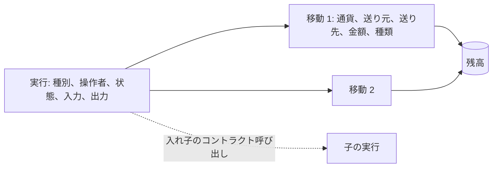
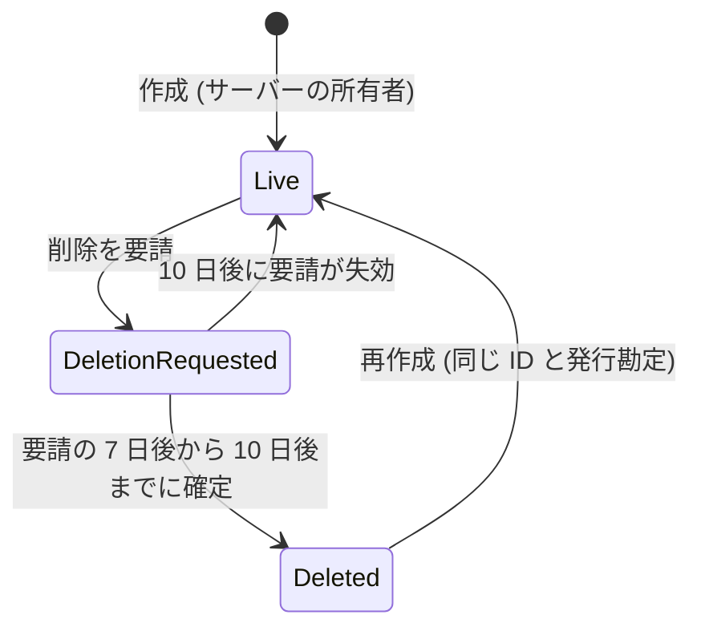
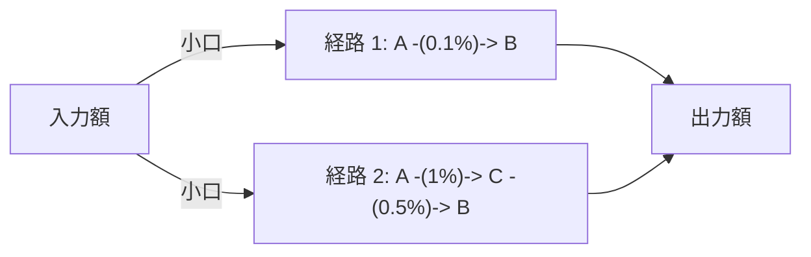

# RapidWire の概念

このページは RapidWire の背後にある考え方 (台帳、通貨とその管理者、送金、許可額と請求、ステーク、DEX、コントラクト) を説明する。
[walkthrough.md](walkthrough.md) はそれらを順を追って実際に使い、リファレンス文書 ([bot.md](bot.md)、[api.md](api.md)、[contracts/](contracts/README.md)) はすべてのコマンド、エンドポイント、規則を詳しく示す。

## 金額

金額はすべて最小単位の整数であり、1 最小単位は通貨の 0.001 なので、金額の小数部はちょうど 3 桁である。
Bot と API は金額を `12.5` のような 10 進数のテキストで受け取って正確に変換し、浮動小数点は一切使わず、小数部が 3 桁を超える値は丸めずに拒否する。
最大の金額は 10^38 - 1 最小単位であり、これを超えることになる操作は何かを書き込む前に失敗する。
0.001 以外に最小金額はなく、誰がどれだけ頻繁に送金や操作をしても制限はない。

## 台帳

RapidWire は残高のあらゆる変化を、1 つのデータベーストランザクションで一緒に書き込む 2 つのテーブルに記録する:

- 実行は、ユーザー、API クライアント、コントラクト、worker のいずれかが行った 1 つの操作であり、その種別 (`transfer`、`mint`、`swap`、`interest`、`contract_call` など)、それを開始した勘定、状態 (`success`、`failed`、`reverted`)、入力、出力またはエラーを持つ。
- 移動は、ある勘定から別の勘定への 1 つの通貨の 1 回の移動であり、金額は常に正で、常にちょうど 1 つの実行に属し、その種類は `principal`、`interest`、`gas` のいずれかである。

残高は移動を積み上げた結果であり、移動を書かずに残高を変えるコード経路はなく、データベースは通貨の発行勘定を除くすべての勘定について負の残高を拒否する。
たとえば 1 つのプールを通るスワップは、2 つの移動 (ユーザーがプールに支払い、プールがユーザーに支払う) を持つ 1 つの実行である。

### 勘定

| 勘定 | ID | 保持するもの |
| --- | --- | --- |
| ユーザー | Discord ユーザー ID (正) | ユーザーのウォレット (ユーザーの最初の台帳操作で作成される) |
| 発行 | 負、通貨ごとに 1 つ | その通貨の供給量の符号を反転した値 |
| ステーク保管 | `-1` | すべての通貨のすべてのステーク額 |
| プール保管 | 負、プールごとに 1 つ | DEX のプールの準備金 |

すべての移動のシステム側は実在の勘定なので、相手の勘定の種類から移動の意味が分かる: 発行勘定からの移動は Mint (種類によっては利息)、発行勘定への移動は焼却、ステーク保管勘定への移動はステークの預け入れ、プール保管勘定への移動はプールへの支払いである。

### 供給量と合計 0 の不変条件

Mint は通貨の発行勘定からウォレットへ金額を移すので、発行勘定はその額だけ負になり、焼却はそれを戻す。
したがって通貨の供給量はどこにも保存されておらず、発行勘定の残高の符号を反転した値であり、各通貨の残高の合計は常に 0 になる。
`rapidwire verify-invariants` はこれと他の台帳の不変条件を検査し、すべてのバックアップは検査した値を記録する。

### 失敗した実行

失敗した操作も、状態 `failed` (コントラクトが取り消した場合は `reverted`)、出力にエラーを持ち、移動を 1 つも持たない実行として記録される: 操作はセーブポイントの中で実行され、失敗した実行を書く前にセーブポイントがロールバックされる。
失敗した実行に残る唯一の移動は、いずれにせよ徴収される手数料、すなわちコントラクト呼び出しのガスであり、種類 `gas` の移動として記録される。
したがって実行の移動は、状態にかかわらず、どのお金が動いたかを常に正確に示す。

### 入れ子の実行

別のコントラクトを呼び出すコントラクトや、組み込み機能を通じて台帳操作を行うコントラクトは、それを呼び出し元の実行の子の実行として行い、子の実行は `parent_execution_id` を設定して同じトランザクションに記録される。
最上位の実行が失敗すると、その子とその移動も一緒に取り消される。

### 冪等性

API の書き込みは、書き込む勘定ごとのスコープを持つ `Idempotency-Key` を受け付け、勘定がすでに使ったキーで書き込みを繰り返すと、再実行せずに最初の結果 (成功または記録済みの失敗) を返す。
Bot は Discord のインタラクション ID をキーとして使うので、Discord が 2 回配信したスラッシュコマンドやボタンの押下は 1 回だけ適用される。

### 旧版から取り込んだ実行

台帳には旧版の RapidWire システムから取り込んだ実行も含まれ、それらは旧版が残した残高を生み出した実行である。
それらはあらゆる一覧に新版の実行と並んで現れ、`origin` は `legacy` であり、`label_basis` が種別の決め方を示す: `row_shape` (旧レコードの形から)、`recalculation`、`binlog`、`owner_decision`、`state_import` (取り込んだ未払いの請求または許可額) のいずれかである。
新版の実行は `origin` が `native` で、`label_basis` を持たない。

## 通貨

Discord のサーバーはそれぞれ 1 つの通貨を持つことができ、その ID はサーバー ID である。
通貨には名前 (24 文字以内で、英字で始まり英字または数字で終わり、記号は単独のアンダースコアを 5 個まで使えるだけ) とシンボル (英大文字と、先頭にも末尾にも置かない単独のハイフン 2 個までからなる 8 文字以内) があり、それらは存続中の通貨の間で一意である。
通貨の作成はその初期供給量 (0 でもよい) を作成者に Mint する。

### 通貨の管理者

管理の権限は、Bot が現時点で把握している Discord サーバーの状態に従い、操作のたびに検査される:

- 通貨を作成できる (削除後の再作成を含む) のはサーバーの所有者だけであり、管理の委任を有効化または無効化できるのも所有者だけである。
- 所有者は通貨を管理する: Mint、Mint 放棄、利率変更、削除。
- 管理の委任が有効な間は、管理者権限を持つロールを保有するすべてのメンバーが、所有者と同じ管理操作を行える。
- サーバーの所有者が変わると、管理の権限は新しい所有者に移る。
- Bot がサーバーを把握できないときは、その所有者と管理者が不明になり、すべての管理操作は `guild_unavailable` で失敗するが、送金や焼却などの保有者の操作は影響を受けない。
- 通貨を作成した勘定は記録のためだけに `created_by` として保持され、各管理実行の操作者が、誰が行ったかを記録する。

Mint は新しい額を、Mint を行った管理者のウォレットに入れる。
焼却は管理操作ではなく、すべての保有者が自分の残高を焼却できる。
Mint 放棄は Mint と利率変更を恒久的に放棄し、予約中の利率変更を取り下げる。

### タイムロック

利率変更と削除は待機期間の後にだけ効力を持つので、保有者は対応できる:

- 利率変更はまず予約され、予約から 7 日後以降に適用でき、失効せず、予約中にできるのは 1 件だけであり、Mint を放棄した通貨は新しい予約を拒否する。
- 削除はまず要請され、要請の 7 日後から 10 日後までの間に確定でき、それを過ぎると要請は失効し、新しい要請がそれを置き換える。

削除の確定は何も残さない 1 つの実行であり、その通貨のすべてのプールを解散し、未払いの請求を取り消し、許可額を削除し、その通貨のすべての残高とステークを発行勘定へ焼却する。
通貨の行は履歴として残り、サーバーの通貨を再作成すると、同じ ID と発行勘定でそれが復活する。

## 送金、許可額、請求

- 送金は送り手のウォレットから別のユーザーへ金額を移し、自分自身への送金は拒否される。
- 許可額は、使用者が持ち主のウォレットからその額まで `transfer_from` で移すことを認めるものであり、`transfer_from` は移した分だけ許可額を減らす。承認は現在の許可額に加算せずに置き換え、0 はそれを削除し、自分自身への承認は拒否される。許可額のあらゆる変更は、それを行った実行とともに履歴に残る。
- 請求は、支払者に請求者へ金額を支払うよう求めるものである。請求は支払者が支払うか、どちらかが取り消すまで未払いのままで、失効することはなく、その説明は 50 文字以内である。支払者はある請求者からの通知を許可でき、そうするとその請求者からの新しい請求はそれぞれ、支払いと拒否のボタンを持つ Bot からの DM として支払者に届き、worker が請求のコミット後にそれを配信する。既定では何も許可されていない。

## ステーク

ステークは、ウォレットからステーク保管勘定へ預け入れた通貨の額であり、そこで通貨の 1 時間あたりの利率を連続複利で得る。

- 利率は 1 時間あたりの ppm (百万分率) の整数で、0 から 1,000,000 (1 時間あたり 100%) までであり、Bot は小数 4 桁までのパーセントで表示し、受け取る。
- `a` 最小単位で繰越額 `c` (1 最小単位未満の端数) のステークを、1 時間あたりの利率 `r` (ppm の値を 1,000,000 で割ったもの) で、前回の計上から `t` 秒後に計上すると、`(a + c) * (1 + r) ^ (t / 3600)` を計算し、その最小単位の整数部が新しい額になり、1 最小単位未満の端数を小数 18 桁に切り捨てたものが新しい繰越額になる。
- 繰越額はステークごとに保持され、次の計上で加算し直されるので、ステークをどれだけ頻繁に計上しても切り捨てが累積することはない。
- 1 時間単位の部分は正確な整数演算で複利計算されるので、ちょうど 1 時間単位の時点では結果は 1 時間ごとの複利と等しく、1 時間に満たない残りの部分は 60 桁の 10 進数のべき乗を使うので、同じ入力は常に同じ結果を与える。
- ステークは、その預け入れと引き出しのそれぞれの直前に、利率変更が適用される直前にはその通貨のすべてのステークについて (したがって新しい利率がそれ以前の時間に適用されることはない)、そしてしばらく誰も触れていないステークについては worker によって計上される。
- 利息を支払う計上はそれぞれ独立した `interest` 実行であり、発行勘定からステーク保管勘定への種類 `interest` の移動を 1 つ持つので、供給量のあらゆる増加は台帳に残る。
- 利息が通貨の供給量を最大の金額より大きくすることはない: そうなる計上は収まる分に切り詰められ、それ以降その通貨は利息を支払わない。引き出しは常に可能である。

## DEX

### プール

プールは 2 つの通貨の準備金を保持し、準備金の定数積によってスワップの価格を決める。
通貨の組はそれぞれ、手数料の段階 (スワップ入力の 1%、0.5%、0.1%、`fee_bps` は 100、50、10) ごとに有効なプールを 1 つ持てるので、1 つの組は最大 3 つのプールを持つことができ、それらは経路探索において別々のプールである。
誰でも両方の通貨を預け入れてプールを作成でき、それが初期価格を決める。

1 つのプールを通るスワップは、入力 `x` に対して `floor(x * (10000 - fee_bps) * reserve_out / (reserve_in * 10000 + x * (10000 - fee_bps)))` を支払い、手数料を含む入力の全額が準備金に加わるので、手数料はプールに残り、その流動性提供者のものになる。

### シェア

- 流動性提供者はプールのシェアを保有し、シェアはプールごとに記録され、譲渡できない。
- プールの作成は `floor(sqrt(amount_a * amount_b))` シェアを発行し、シェアは金額と同じ 1000 分の 1 単位で数える。そのうち最初の 1,000 (Bot が表示するシェアでは 1.000) はプールに恒久的にロックされるので、最初の預け入れはそれより多くを発行しなければならず、作成者は残りを受け取る。最小流動性分は、ほとんど空のプールを通じてシェアの価格が操作されることを防ぐ。
- 流動性の追加はプールの現在の比率で預け入れ、一方の額をすべて使い、もう一方を比率が必要とするだけ使って、2 つの比例するシェア数のうち小さい方を切り捨てて発行する。
- 流動性の削除はシェアを焼却し、各通貨について `floor(shares * reserve / total_shares)` を支払う。
- 最小値 (API の `amount_x_min`、`amount_y_min`、`min_shares`) は、価格が動いた状態で預け入れや引き出しが完了する代わりに失敗させる。

通貨が削除されると、その各プールは解散される: 削除された通貨の準備金は焼却され、相手通貨の準備金は最小流動性分を除くシェアに比例して提供者に支払われ、各支払いは切り捨てられ、端数は最大の提供者 (同数の場合は勘定 ID が最も小さい者) に与えられる。
提供者のシェアが残っていない場合、相手通貨の準備金は相手通貨の発行勘定へ焼却される。
解散したプールは履歴として残り、その組と段階は新しいプール ID のもとで再作成できる。

### 経路と配分

スワップは複数のプールを通過できる。
経路は、支払う通貨から受け取る通貨へ至る 1 から 5 個の異なるプールの列であり、同じ組の 2 つの段階は別のプールである。
サーバーは、入力の小口 1 つが各経路で受け取る額で順位付けした候補経路を最大 `RAPIDWIRE_SWAP_MAX_ROUTES` 個見つけ、次に入力を `RAPIDWIRE_SWAP_CHUNK_COUNT` 個の小口に分け、各小口をその時点でそれに対して最も多く受け取る経路に与え、次の小口の前にその経路上のすべてのプール (複数の経路が共有するプールを含む) の模擬準備金を更新する。
定数積のプールは入力の追加 1 単位ごとに支払う額が減るので、このように入力を分散するとどの単一経路よりも多く受け取れ、分割が厳密に良くならない場合は最良の単一経路を使う。
`GET /v1/config` は両方の設定を報告する。

見積もりは、何も書き込まずに配分 (各経路の入力と出力をホップごとに) と合計を報告する。
スワップはすべての候補プールをロックし、ロックした準備金で配分を計算し直し、合計が API で必須の `min_out` を下回る場合は何も動かさずに失敗し、Bot の確認ボタンは表示した見積もりの 99% を `min_out` として使う。
完了したスワップは 1 つの実行であり、その移動はユーザーから最初のプールへ、プール間で、そして最後のプールからユーザーへと向かう。

## コントラクト

コントラクトはユーザーの勘定に結び付けられたプログラムであり、小さな Python 風の言語で書かれ、`rwc` で RWC1 バイナリにコンパイルされ、サーバーが登録時にそれを検証する。
他のユーザーはその公開関数を呼び出し、任意で 1 つの通貨で代金を添付でき、コントラクトはユーザーと同じ公開の台帳操作 (送金、許可額、請求、ステーク、スワップ、流動性) を通じて動作し、型付きのストレージを保持し、それを許可したサーバーで Discord のメッセージとロールの変更をキューに入れられる。

- すべての呼び出しは 1 つの実行であり、他のコントラクトへの入れ子の呼び出しはその子であり、失敗した呼び出しはその効果をすべて取り消して添付した額を返す。
- すべての命令はガスで計量され、最上位の呼び出し元が使用したガスをガス代の通貨 (既定では RAPID) で支払い、それは焼却される。コードの開始後に失敗した呼び出しも使用したガスを支払うが、開始しなかった呼び出しは何も支払わない。
- `random()` を除き実行は決定的であり、`random()` が引いた値は実行とともに記録されるので、誰でも後から結果を確かめられる。
- Discord のメッセージとロールの変更は outbox を経由し、呼び出しのコミット後に worker が配信し、配信の失敗が実行を変えることはない。
- コントラクトのバイナリのすべてのバージョンとそのストレージは公開されており、持ち主は、ユーザーがそのコードを信頼できるように、コントラクトを更新できないようロックできる。

[contracts/README.md](contracts/README.md) はコントラクトを紹介し、言語、組み込み機能、ガスのコスト、`rwc` ツール、バイナリ形式へのリンクとサンプルコントラクトを示す。
