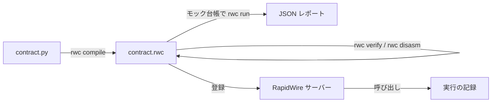

# RapidWire スマートコントラクト

コントラクトは、RapidWire の勘定に結び付けたプログラムである。
他の利用者はその公開関数を呼び出し、任意で 1 つの通貨の代金を添付できる。
コントラクトは、書かれたとおりの台帳操作、ストレージ操作、Discord 操作でこれに応じる。
典型的な用途は、ロールの自動販売機、運が絡むゲーム、会員限定のサービス、固定レートの両替窓口であり、[サンプル](#サンプル) にそれぞれ 1 つずつ例がある。

## モデル

- 1 つの勘定が持つコントラクトは最大 1 つであり、コントラクトの資金はその勘定のウォレットである。コントラクトの中では、その勘定を `self` と書く。
- コントラクトは、型付きの引数 (int、str、bool、Account、Currency) と型付きの結果 (int、str または bool) を持つ公開関数を持つ。結果は実行の出力として記録され、呼び出し元に返る。
- 呼び出しには 1 つの通貨を添付できる。添付した額は呼び出しの開始時にコントラクトへ移り、呼び出しが失敗すると戻る。
- 呼び出しはそれぞれ 1 つの実行である。失敗すると、その効果はすべて取り消され、ガス代だけが徴収される。
- 呼び出しはガスで計量され、ガス代は最上位の呼び出し元が RAPID で支払い、焼却される ([costs.md](costs.md) を参照)。
- コントラクトは他のコントラクトを呼び出すことができ、その失敗を `try_call` で受け止められる。
- コントラクトのストレージは公開されており、バイナリのすべての版も同様である。

## 作業の流れ

1. ソースを [コントラクト言語](language.md) で書く。`from rapidwire_contract import *` を置き、エディタの支援には `rwc stub` が出力するスタブを使う。
2. `rwc compile` でコンパイルし、`rwc verify` で検査し、状態ファイルを使って `rwc run` で試す ([cli.md](cli.md) を参照)。
3. バイナリを持ち主の勘定に登録する。サーバーはそれを検査し ([binary-format.md](binary-format.md#登録時の検査) を参照)、SHA-256 とともに新しい版として保存する。登録にガスはかからない。
4. Discord 操作を使う場合は、各サーバーの管理者が `/discord-permission allow` でそのサーバーでのコントラクトの操作を許可する。

持ち主はコントラクトを次のように管理する。

- 再び登録すると新しい版が保存される。すべての版は引き続き取得できる。
- ロックできるのは有効なコントラクトだけである。終了時刻付きのロックは、その時刻まで更新、停止、再開、削除を禁じるので、利用者はコードが変わらないことを当てにできる。ロック中にできるのは延長だけである。
- ロックされていないコントラクトは、停止 (呼び出しは `CALL_FAILED` で失敗する)、再開、削除ができる。削除するとストレージが消去され、再び登録すると新しい版として復活する。
- ドライランは、台帳を変えずに呼び出しを実行し、その結果、ガス、移動、キューに入った Discord 操作を報告する。

## ドキュメント

| ドキュメント | 内容 |
| --- | --- |
| [language.md](language.md) | 型、文、式、拒否される構文、コントラクトの呼び出し、失敗と上限 |
| [builtins.md](builtins.md) | すべての組み込み機能のシグネチャ、動作、失敗、ガス |
| [costs.md](costs.md) | ガス単価、すべての命令と組み込み機能のコスト、サイズによる加算 |
| [cli.md](cli.md) | `rwc` ツール、`rwc run` の状態ファイル、エディタの設定 |
| [binary-format.md](binary-format.md) | RWC1 の構成と登録時の検査 |

## サンプル

[samples/](samples) の各サンプルは完結したコントラクトであり、`rwc run` 用の状態ファイルの例が付いている。
動作の説明はそれぞれのモジュール docstring にある。

| サンプル | 用途 | 試し方 |
| --- | --- | --- |
| [role_vending.py](samples/role_vending.py) | Discord のロールを RAPID で販売し、払い過ぎた分を返す | `rwc run role_vending.py --state role_vending.state.json --function buy --pay RAPID:120000` |
| [lottery.py](samples/lottery.py) | コントラクトの胴元資金から払い出すサイコロの賭けで、`random()` を使う | `rwc run lottery.py --state lottery.state.json --function bet --arg int:4 --pay RAPID:10000 --seed 3` |
| [members_only.py](samples/members_only.py) | VIP またはロールの保有者向けの日次報酬とクラブへの投稿 | `rwc run members_only.py --state members_only.state.json --function collect` |
| [exchange_broker.py](samples/exchange_broker.py) | 在庫を使う固定レートの GOLD 窓口で、在庫が足りないときは `min_out` 付きの `swap` を使う | `rwc run exchange_broker.py --state exchange_broker.state.json --function buy --pay RAPID:30000` |

コマンドは samples ディレクトリで実行する。
どの呼び出しも既定のガス上限に収まる。
