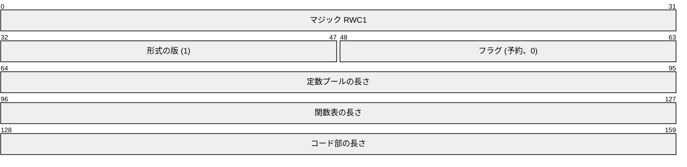

# RWC1 バイナリ形式

コントラクトは、圧縮しない RWC1 バイナリとして登録、保存、実行される。
ファイルは固定長 20 バイトのヘッダーに続けて、定数プール、関数表、コード部をこの順に並べたものであり、それ以外のバイトは含まない。
固定長の整数はリトルエンディアンである。

## ヘッダー

- マジックは 4 つの ASCII バイト `RWC1` である。
- 形式の版は命令セットを識別する。版 1 が唯一の版であり、サーバーは受け付けたすべての版を実行する。
- 3 つの長さは u32 のバイト数であり、ヘッダーと 3 つの部の合計はファイルサイズとちょうど一致しなければならない。

## 符号化

- uvarint: 最大 64 ビットの符号なし LEB128 で、最短の形をとる。それより長い形は拒否されるので、受け付けられたバイナリはすべて、符号化し直すと同じバイト列になる。
- 符号付きの命令オペランドは、zigzag 符号化した uvarint である。
- 型木は、タグバイトに続けて、list なら要素の型、dict ならキーと値の型を並べたものである。

| タグ | 型 |
| --- | --- |
| 0 | None |
| 1 | int |
| 2 | str |
| 3 | bool |
| 4 | Account |
| 5 | Currency |
| 6 | list (要素の型が 1 つ続く) |
| 7 | dict (キーと値の型が続く) |
| 8 | Value |
| 9 | CallResult |
| 10 | Paid |
| 11 | CurrencyInfo |
| 12 | ClaimInfo |
| 13 | Quote |

## 定数プール

エントリは部の終わりまで続けて並ぶ。
各エントリは、タグバイト、uvarint の本体の長さ、本体からなる。

| タグ | 本体 |
| --- | --- |
| 1 | 厳格な UTF-8 の str |
| 2 | 2 の補数、リトルエンディアンで、値を保持できる最小のバイト数で表した int (0 は空の本体) |
| 3 | 本体全体を占める 1 つの型木 |

str は関数名、文字列リテラル、失敗メッセージを、int はインラインのオペランドには大きすぎる整数を、型は `CHECK_TYPE` の対象を保持する。

## 関数表

エントリは部の終わりまで続けて並ぶ。
各エントリは次のものを持つ。

| フィールド | 符号化 |
| --- | --- |
| 名前 | str 定数の uvarint の番号 |
| フラグ | 1 バイト。公開関数ならビット 0 を立て、他のビットは 0 |
| 引数の数 | uvarint |
| 引数の型 | その数の型木 |
| 戻り値の型 | 型木 |
| 局所変数の数 | uvarint。引数の数以上で、引数が最初の局所変数を占める |
| コードの位置 | uvarint。コード部の先頭からの相対位置 |
| コードの長さ | uvarint |

## コード部

すべての関数のコードであり、それぞれが、1 バイトの命令コードとそれに続く uvarint のオペランドからなる命令の並びである。
命令コード、そのバイト値、コストは [costs.md](costs.md#命令のコスト) に挙げている。
ジャンプ先は関数の先頭からのバイトオフセットである。
関数の範囲は、隙間も重なりもなく、コード部をちょうど覆わなければならない。

## 登録時の検査

サーバーは登録時にすべてのバイナリを検査し、最初に失敗した検査で拒否する。
`rwc verify` は同じ検査を行う。

- サイズが登録時の上限 (8,000 バイト) 以下である。
- ヘッダーがマジック、対応する版、0 のフラグを持ち、各部の長さの合計がファイルサイズと一致する。
- 定数プールと関数表が最後まで読める。str は正しい UTF-8 で、int は最短の形かつ int の上限内、str は str の上限内、型は正しい形 (入れ子は最大 8 段、dict のキーはキーとして使える型) である。
- 関数が少なくとも 1 つある。名前は互いに異なる最大 64 文字の ASCII 識別子で、`__` で始まらず、str 定数を参照する。
- 関数の引数は最大 16 個、局所変数は最大 256 個である。公開関数の引数はスカラーで、公開関数の戻り値の型は int、str または bool である。
- 関数のコードの範囲がコード部をちょうど敷き詰める。
- すべての命令コードが定義されており、すべての命令がその関数の中で終わり、すべてのオペランドが実在するものを参照する。対象は、正しい種類の定数、その関数の局所変数、関数、組み込み機能、レコードの種類とフィールドである。フラグのオペランドに未定義のビットはなく、組み込み機能の呼び出しは受け付けられる数の引数を渡す。
- すべてのジャンプ先が同じ関数の命令の先頭であり、実行が関数の末尾から抜け出ることはない。
- すべての経路で、オペランドスタックは不足せず、128 個の値を超えず、経路が合流する場所では同じ深さであり、return の時点ではちょうど戻り値だけを持つ。
- 到達可能なループで、コスト 0 の命令だけでできたものはない。

オペランドの型は代わりに実行時に検査される。
型の不一致はコントラクトの `RUNTIME` 失敗である。

## コントラクトの確認

登録された各版のバイナリとその SHA-256 は保持され、誰でも取得できる。
`rwc disasm` はそのようなバイナリの関数表と命令を出力し、利用者はこれで呼び出す前にコントラクトの動作を確かめる。
