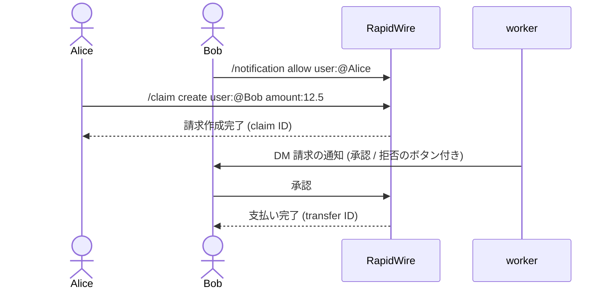

# はじめての操作

この手順の解説では、小さなコミュニティが RapidWire を使う様子を追う: Alice は Discord のサーバーを所有してその通貨を発行し、メンバーは互いに支払い、ステークし、DEX に市場を開いてスワップし、そのうちの 1 人が同じ手順を HTTP API で自動化する。
各手順では、スラッシュコマンドと、Python クライアント ([client/README.md](../client/README.md)) を通じた `/v1` API の同等の呼び出しを示す。
各手順の背後にある考え方は [concepts.md](concepts.md) が説明し、すべてのコマンドは [bot.md](bot.md) が、すべてのエンドポイントは [api.md](api.md) が記載している。

Bot は日本語で応答し、以下のコマンドは Discord が表示する形 `/command parameter:value` で書いている。
例では、Alice のサーバーの通貨 `EXM`、通貨 `RAPID`、ユーザー Alice、Bob、Carol、Dave を使う。
`rapidwire bot --list-commands` はすべてのコマンドをパラメータとともに出力する。

## クライアントの準備

API の手順は、API トークンを持つ同期クライアントを前提とし、トークンは Bot をメンションすると発行される ([API トークンの取得](#api-トークンの取得) を参照)。
読み取りにはトークンが不要であり、書き込みはすべてトークンの勘定として実行される。

```python
from decimal import Decimal

from rapidwire_client import RapidWireClient, new_idempotency_key

client = RapidWireClient("https://rapidwire.example.com", token=TOKEN)
exm = client.get_currency_by_symbol("EXM").currency_id
rapid = client.get_currency_by_symbol("RAPID").currency_id
```

金額は通貨単位の `Decimal` または `str` で小数 3 桁までであり、ID は `int` である。

## 1. Alice がサーバーの通貨を作成する

サーバーの通貨を作成できるのはそのサーバーの所有者だけであり、そのサーバーの中で作成する。
初期供給量は Alice に渡り、ステークの利率は 1 時間あたりのパーセントで指定する。

```text
/currency create name:Example symbol:EXM supply:1000000 hourly_interest_rate:0.01
/currency info symbol:EXM
```

API は利率を 1 時間あたりの ppm (`0.01` パーセントは `100`) で、サーバー ID を `guild_id` として受け取る:

```python
created = client.create_currency(GUILD_ID, "Example", "EXM", Decimal("1000000"), hourly_rate_ppm=100, idempotency_key=new_idempotency_key())
info = client.get_currency(created.currency_id)
```

通貨の ID はサーバー ID であり、その供給量は発行勘定の残高の符号を反転した値である。
Alice がサーバーの管理者にも通貨を管理させたい場合は、`/currency delegation enable` (`client.enable_delegation(currency_id)`) を実行する。

## 2. 互いに支払う

Alice は Bob に EXM を送り、誰でも Bob の残高を見られる:

```text
/transfer user:@Bob amount:250 symbol:EXM
/balance user:@Bob
```

```python
sent = client.transfer(BOB, exm, Decimal("250"), idempotency_key=new_idempotency_key())
balances = list(client.paginate(client.list_balances, BOB))
```

Alice のサーバーの中では、`symbol` パラメータの既定値がサーバーの通貨なので、省略できる。
同じリクエストを同じ冪等キーで再び送ると、2 回支払う代わりに最初の結果が返り、どちらが起きたかは `sent.replayed` が示す。

## 3. 許可額

Bob は Carol に自分の残高から最大 50 EXM を使うことを認め、Carol はそこから Dave に 20 EXM を支払う:

```text
/approve set user:@Carol amount:50 symbol:EXM
/transfer_from source:@Bob destination:@Dave amount:20 symbol:EXM
/approve info user:@Carol symbol:EXM
```

```python
client.approve(CAROL, exm, Decimal("50"))  # as Bob
client.transfer_from(BOB, DAVE, exm, Decimal("20"))  # as Carol
remaining = client.get_allowance(BOB, CAROL, exm).amount
```

承認は許可額に加算せずに新しい額に設定し、`0` を承認すると許可額は削除される。

## 4. 請求

Alice は Bob に昼食代の支払いを求める。
Bob はまず Alice からの請求の通知を許可するので、Bot は Alice の請求ごとにボタン付きの DM を Bob に送る。
許可しなければ、請求は作成されるが Bob には通知されない。

```text
/notification allow user:@Alice
/claim create user:@Bob amount:12.5 description:Lunch
/claim list
/claim pay claim_id:<claim id>
```

```python
client.allow_notifications(ALICE)  # as Bob
claim = client.create_claim(BOB, exm, Decimal("12.5"), description="Lunch")  # as Alice
client.pay_claim(claim.claim_id)  # as Bob
```

`/claim create` は、それを実行したサーバーの通貨を使う。
Bob は `/claim pay` の代わりに DM の `承認` を押すことも、`拒否` を押して請求を取り消すこともでき、どちらの側も `/claim cancel` で取り消せる。



## 5. ステーク

Bob は 100 EXM をステークし、通貨の 1 時間あたりの利率を連続複利で得る:

```text
/stake deposit amount:100 symbol:EXM
/stake info
/stake withdraw amount:50 symbol:EXM
```

```python
client.deposit_stake(exm, Decimal("100"))
stake = client.get_stake(BOB, exm)
print(stake.amount, stake.projected_amount)
client.withdraw_stake(exm, Decimal("50"))
```

利息は、各預け入れまたは引き出しの直前と、worker による定期的な計上で、別個の `interest` 実行によって加算されるので、`stake.amount` は最後の計上時点の額であり、`projected_amount` は現時点での額である。

## 6. 市場を開く

Alice は手数料の段階 0.5% で EXM と RAPID のプールを作成し、初期価格を 1 RAPID あたり 2 EXM に設定する:

```text
/lp create symbol_a:EXM amount_a:10000 symbol_b:RAPID amount_b:5000 fee_tier:0.5%
/lp info symbol_a:EXM symbol_b:RAPID
/lp list
```

```python
pool = client.create_pool(exm, rapid, 50, Decimal("10000"), Decimal("5000"))
print(pool.pool_id, pool.shares, pool.locked_shares)
positions = list(client.paginate(client.list_positions, ALICE))
```

最初の預け入れは 2 つの額の積の平方根に等しいシェアを発行し、そのうち 1.000 (API の生のシェア数では 1,000) はプールに恒久的にロックされる。
他のユーザーは `/lp add` (`client.add_liquidity`) で現在の比率で流動性を追加し、`/lp remove` (`client.remove_liquidity`) で引き出す。

## 7. スワップ

Dave は 10 RAPID を EXM にスワップする:

```text
/swap from_symbol:RAPID to_symbol:EXM amount:10
```

Bot は見積もりを、使用するすべてのプールを通る経路とともに、30 秒間有効な `確定` と `キャンセル` のボタンを添えて Dave だけに表示する。
`確定` は再度見積もりを行い、新しい見積もりが表示したものの 99% 以上である場合にだけスワップし、その 99% を下回る結果は受け入れない。

API は 2 つの手順を分けており、`min_out` は必須である:

```python
from rapidwire_client import from_units, to_units

quote = client.quote_swap(rapid, exm, Decimal("10"))
min_out = from_units(to_units(quote.amount_out) * 99 // 100)
result = client.swap(rapid, exm, Decimal("10"), min_out, idempotency_key=new_idempotency_key())
```

プールが大きく動いて結果が `min_out` を下回る場合、スワップは `slippage_exceeded` で失敗し、失敗した実行として記録され、何も動かさない。

## 8. 履歴を見る

すべての勘定のすべての移動は公開されている:

```text
/history currency_symbol:EXM
/history user:@Bob start_date:2026-11-01 end_date:2026-11-05
/history transfer_id:<transfer id>
```

```python
from datetime import UTC, datetime

page = client.get_account_history(BOB, currency_id=exm, start=datetime(2026, 11, 1, tzinfo=UTC), end=datetime(2026, 11, 6, tzinfo=UTC))
execution = client.get_execution(page.items[0].execution_id)
```

Bot は日付を日本標準時の日として読み、`end_date` を含めるが、API は UTC オフセット付きの時刻を受け取り、`end` を含めない。
Web エクスプローラーは同じデータを `/explorer.html`、`/account.html?id=<account id>`、`/execution.html?id=<execution id>` で表示する ([web.md](web.md))。

## 9. コントラクトを呼び出す

ユーザーのコントラクトは、その公開関数と型付きの引数を指定し、任意で代金を支払って呼び出し、呼び出し元はガスを RAPID で支払う:

```text
/contract info user:@Shop
/contract call user:@Shop function:buy pay:120 currency:RAPID
```

```python
from rapidwire_client import Attachment

result = client.call_contract(SHOP, "buy", [], attach=Attachment(currency_id=rapid, amount=Decimal("120")))
print(result.value, result.gas_used, result.gas_cost)
```

`client.dry_run_contract` は同じ呼び出しを実行してロールバックし、何が行われるかを報告する。
コントラクトの作成と登録は [contracts/README.md](contracts/README.md) で説明している。

## API トークンの取得

Bot への DM の中、または Bot がいるサーバーの中で、`API` を付けて Bot をメンションする:

```text
@RapidWire API
@RapidWire API 123456789012345678
```

チャンネル ID がなければトークンは DM で届き、チャンネル ID があれば Bot は同じサーバーのそのチャンネルにトークンを投稿する。
トークンを発行すると勘定の以前のトークンは無効になり、`client.revoke_tokens()` は有効なトークンを無効にする。
