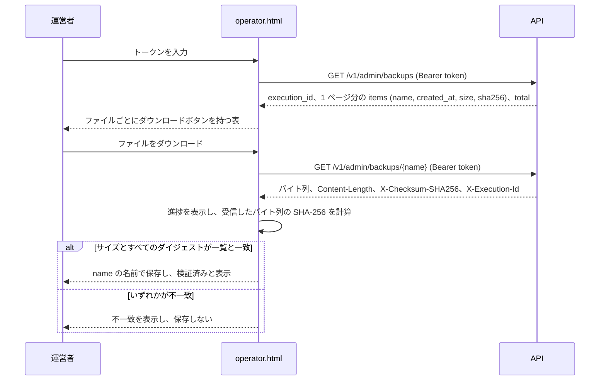

# Web エクスプローラー

Web エクスプローラーは `rapidwire/web/` にある静的ページの集まりであり、API のプロセスが `/v1`、`/docs`、`/openapi.json` 以外のすべてのパスで配信する ([api.md](api.md#概要) を参照)。
ページは素の HTML で、それぞれ 1 つの JavaScript モジュールと共通の `assets/app.js`、`assets/app.css` を持ち、プールを表示するページはこれに `assets/dex.js` を加える。
ビルド工程はなく、別のオリジンから読み込むものもない。
どのページも空の `data:` アイコンを宣言しているため、ブラウザは `/favicon.ico` を要求しない。
どのページも同じオリジンの公開 `/v1` API から `GET` リクエストでデータを読むため、API が誰にでも返す内容をそのまま表示し、後述の運営者用ページを除いてトークンを送ることはない。
ブラウザには何も保存しない: `localStorage`、`sessionStorage`、cookie、IndexedDB、cache storage、service worker はいずれも使わず、API の結果は開いているページのメモリ上にだけ保持する。

## 公開データ

すべての勘定の残高と取引 (実行と移動) は常に公開されている: どの訪問者も、負の ID を持つシステム勘定を含むあらゆる勘定を開き、その残高、ステーク、流動性ポジション、移動の履歴、実行を見ることができ、その範囲は API が認証なしで返す範囲と同じである。
通知の許可、Discord 権限、API トークンを変更する実行は、API が返すとおり、入力が空で出力がないものとして表示される。

## ページ

| ページ | パス | 表示内容 |
| --- | --- | --- |
| トップ | `/` | 通貨、実行、移動の現在の件数を示す入口のページ |
| エクスプローラー | `/explorer.html` | 新しい順のすべての実行 (種類、状態、操作者で絞り込み)、最新の移動、`?q=` による検索 |
| 勘定 | `/account.html?id=<account_id>` | 勘定の名前 (システム勘定ではその正体と、属する通貨またはプール)、続いて統計、残高、ステーク、流動性ポジション、請求、移動の履歴、その勘定が開始した実行 |
| 通貨 | `/currency.html?id=<currency_id>` または `?symbol=<symbol>` | 通貨のすべてのフィールドと移動の履歴 |
| 移動 | `/transfer.html?id=<transfer_id>` | 1 件の移動と、それを行った実行 |
| 実行 | `/execution.html?id=<execution_id>` | 1 件の実行と、そのエラー、移動、入れ子の実行、Discord への配送、生の入力と出力 |
| プール一覧 | `/pools.html` | すべての有効なプールと、1 つのペアの手数料の段階の比較 |
| プール | `/pool.html?id=<pool_id>` | プールのすべてのフィールド、スポット価格、同じペアの他の段階、最新の移動 |
| コントラクト | `/contract.html?id=<account_id>` | コントラクトの状態、公開関数、ストレージ、バージョン、そのすべての呼び出し |
| 運営者 | `/operator.html` | 運営者向けのバックアップの一覧とダウンロード |
| 見つからない | それ以外のすべてのパス (`/404.html` を含む) | 要求されたパスを示す 404 ページ (ステータス 404 で配信) |

ファイルは正規のパスでのみ配信する: `/`、または英字、数字、`.`、`_`、`-` からなり `.` で始まらないファイル名をスラッシュで区切ったものを、クライアントが送ったとおりの形で受け付ける。
そのため、空のセグメント (`//`)、`.` や `..` のセグメント、パーセントエンコードされた文字 (`%2f` や `%2e` など)、バックスラッシュ、末尾のスラッシュを含むパスは、ファイルに解決できる場合でも 404 ページになる。
404 ページには専用のパスがない: `/404.html` への GET または HEAD は、他の存在しないパスと同じ本文とヘッダーでステータス 404 を返す。
現在のページにとどまるリンクとフォームは、そのパスが単一の `/` で始まる場合に限りパスから URL を組み立て、そうでない場合は `?` とクエリから現在の文書に対する相対 URL を組み立てるため、常にこのオリジン内にとどまる。

### URL の形式

- 詳細ページは対象を `/<page>.html?id=<id>` の形で指定し、ID は 10 進数の文字列である。ID が無いか形式が不正な場合はリクエストを送らずにエラーを表示し、API が知らない ID では "見つかりません / Not found" を表示する。
- ページ分割された一覧はそれぞれ専用のページ番号のパラメータ (1 から) を持ち、ページ送りのリンクはそのページの他のパラメータを保ったまま一覧の見出しに戻るため、一覧のどのページもリンクで表せる。
- 一覧の先頭 10,000 件を超える位置に達するページ番号は API が拒否するため、ページ自身が最初のページへのリンクを添えて拒否する。一覧の末尾を過ぎたページは空であることを示し、その "前へ" のリンクは最後のページへ導く。
- プール一覧のページは、ID またはシンボルで指定した 2 つの通貨 `x` と `y` を受け取り、そのペアのプールを比較する。シンボルは `GET /v1/currencies/symbol/{symbol}` で解決する。

### ページのパラメータ

| ページ | パラメータ |
| --- | --- |
| `/explorer.html` | `page` (実行)、`execution_type`、`status`、`initiator_id` (絞り込み)、`q` (検索) |
| `/account.html` | `id`、`tab` (保有資産のタブ)、`bp` (残高)、`sp` (ステーク)、`lp` (流動性ポジション)、`cp` (請求)、`cs` (請求の状態)、`cr` (請求の立場)、`hp` (移動の履歴)、`currency_id`、`sort_by`、`sort_order` (履歴の絞り込みと並べ替え)、`ep` (実行) |
| `/currency.html` | `id` または `symbol`、`hp` (移動の履歴)、`sort_by`、`sort_order` (履歴の並べ替え) |
| `/transfer.html` | `id` |
| `/execution.html` | `id` |
| `/pools.html` | `page` (有効なプール)、`x`、`y` (ペア) |
| `/pool.html` | `id` |
| `/contract.html` | `id`、`spage` (ストレージ)、`vpage` (バージョン)、`cpage` (呼び出し) |

### 検索

どのページにもあるヘッダーの検索は `/explorer.html?q=` へ移動する。
通貨のシンボルは `GET /v1/currencies/symbol/{symbol}` で調べる。
正の ID は実行、移動、通貨、勘定 (`GET /v1/accounts/{account_id}`)、コントラクトとして同時に調べ、負の ID は勘定としてのみ調べる。
結果になるのは実在する項目だけである: ちょうど 1 件が実在し、すべての照会が応答した場合はそのページを直接開き、複数件が実在する場合はリンクとして一覧にし、1 件も実在しない場合は一致するものがないと表示する。
404 以外の理由で失敗した照会は結果の下に報告され、その場合の検索がページを自動で開くことはない。

### 値の表示

- ID、金額、プールのシェアは JSON 文字列として届き、文字列のまま扱う: 金額は文字列操作によって桁区切りと小数 3 桁ちょうどで表示し、プールのシェア、提供者のシェア (`total_shares - locked_shares`)、スポット価格は浮動小数点ではなく常に `BigInt` で計算する。
- 手数料の段階は `fee_bps` を百分率にして表示する (100 は 1%、50 は 0.5%、10 は 0.1%)。
- プールのスポット価格は準備金の正確な比を小数 8 桁に四捨五入したもので、手数料を含まない。準備金のないプールには価格がない。
- 時刻は JST で表示し、UTC の値を要素の `datetime` とツールチップに持たせる。
- API からのテキストは常に HTML ではなくテキストとして挿入するため、コントラクトのストレージの文字列や関数名がマークアップを注入することはない。ストレージの `str` 値はエスケープを含む JSON の文字列リテラルとして、`Account` や `Currency` の値はリンクとして、list と dict は入れ子のリストとして表示する。
- コントラクトのページは各バージョンの SHA-256 とサイズを表示するが、バイナリを要求することはない。
- コントラクトのページは `GET /v1/executions?contract_id=<account_id>&execution_type=contract_call` によってそのコントラクトのすべての呼び出しを新しい順に一覧にする: ユーザーからの呼び出しと他のコントラクトからの入れ子の呼び出しを、成功か否か、何かを動かしたか否かにかかわらず含む。
- 勘定のページの統計は、その勘定がどちらか一方の側にある移動の正確な件数を示す。
- 勘定のページの請求タブは、その勘定が行った請求とその勘定に対して行われた請求を一覧にし、状態 (`cs`) と勘定の立場 (`cr`: 行った請求は `claimant`、行われた請求は `payer`) で絞り込む。

### 勘定の表示名

- ユーザー勘定はその ID で表示し、人を示す箇所 (履歴、実行、請求) では `GET /v1/users/{account_id}/name` による Discord のユーザー名に続けて ID を表示する。ユーザー名が見つからない場合 (404) や Discord が利用できない場合 (503) は ID だけを表示する。
- システム勘定はその正体で表示する: 勘定 `-1` はステーク保管勘定 ("ステーク預かり / Stake custody")、発行勘定はその通貨のシンボルに続けて "発行"、プール保管勘定は `Pool #<pool_id>` に "カストディ" とペアのシンボルを続けた名前として表示する。リンクは変わらず勘定のページへ導き、そのツールチップに勘定 ID を持たせる。
- システム勘定の種類は `GET /v1/accounts/{account_id}` から、発行勘定の通貨のシンボルはページが既に読んだ通貨一覧または `GET /v1/currencies/{currency_id}` から、プール保管勘定のペアは `GET /v1/pools/{pool_id}` から得る。通貨やプールを既に読んだページは、その発行勘定や保管勘定をリクエストなしで表示する。
- 各ユーザー名、勘定、通貨、プールは、見つかったか 404 が返った後は 1 回のページ読み込みにつき最大 1 回しか要求せず、同時の利用は 1 つのリクエストを共有し、応答は開いているページのメモリ上にだけ保持する。
- 他の理由 (5xx の応答や接続なし) で失敗した照会は保持しないため、ページ上の次の利用で再び照会する。それまでシステム勘定は仮の表示名 `System #<account_id>` のまま、または通貨やプールの照会だけが失敗した場合はシンボルやペアを除いた種類のままとなり、通貨一覧はそれを必要とするページの次の部分が再び要求する。
- 負の ID の勘定のページは、勘定の種類と作成時刻を表示し、発行勘定ではその通貨と供給量 (勘定の残高は供給量の符号を反転したもの)、プール保管勘定ではそのプール、ペア、手数料の段階を表示する。勘定のない負の ID は存在しないと報告する。
- 勘定のない正の ID (`GET /v1/accounts/{account_id}` が 404 を返す) の勘定のページはエラーにならない。Discord のユーザー ID は最初の台帳操作より前から有効だからである: ページは台帳にまだその勘定の記録がないという注記を、その勘定が開始した失敗した実行を除いて空の一覧とともに表示する。
- 勘定のページは `GET /v1/executions?initiator_id=<account_id>` によってその勘定が開始した実行を新しい順に、種類、状態、由来、時刻、コントラクト関数とともに一覧にし、同じ操作者で絞り込んだエクスプローラーへのリンクを置く。

### 旧版から取り込んだ実行

旧版から取り込んだ実行は、新版の実行と同じ一覧に現れる。
実行をその種類で表すすべての箇所 (実行の一覧、子の実行、移動の履歴とフィード、移動と実行のページ) で、`origin` が `legacy` の実行には "旧版 / legacy" のバッジと、その種類がどう決まったか (その `label_basis`: 記録の形から、再計算により、binlog から、運営者の判断により、または取り込んだ状態として) が付き、新版の実行には "native" の印が付く。
実行へのすべてのリンクは、API がリンクの ID の隣に返す由来のフィールドから、リンク先の実行について同じバッジを持つ: 請求の作成と解決の実行、プールの作成と解散の実行、コントラクトの作成と更新の実行、各バージョンを登録した実行、移動の実行、そして実行の一覧と移動および実行のページでの入れ子の実行の親 (`parent_origin`) である。
実行のページの子の実行へのリンクは、その実行のレスポンスに含まれる子からバッジを得る。
運営者用ページが自身の `backup_list` と `backup_download` の実行へ張るリンクは、API が応答時にそれらを記録するため native と表示する。

### 狭い画面

幅 45rem 未満では、データの表は行ごとに 1 枚の積み重ねたカードになり、各セルにはその列の名前が付く。
表は明示的な ARIA の table ロールを保つため、支援技術は引き続き表として読み上げる。
積み重ねたカードの中の ID、金額、ダイジェスト、バッジは狭い画面では必要に応じて折り返すため、最大の金額でもページの幅を広げない。
広い画面では表の中の ID と金額を 1 行に保ち、収まらない表はその枠の中でスクロールする。

## レスポンスヘッダー

Web のマウントは、配信するすべてのレスポンスにこれらのヘッダーを付ける。
404 ページ、`304 Not Modified` の応答、GET と HEAD 以外のメソッドに対する JSON の `405` エラーも含む。
`/v1`、`/docs`、`/openapi.json` のレスポンスには付かない。

| ヘッダー | 値 |
| --- | --- |
| `Content-Security-Policy` | `default-src 'self'; script-src 'self'; style-src 'self'; img-src 'self' data:; connect-src 'self'; object-src 'none'; base-uri 'none'; form-action 'self'; frame-ancestors 'none'` |
| `X-Content-Type-Options` | `nosniff` |
| `Referrer-Policy` | `no-referrer` |
| `Cross-Origin-Opener-Policy` | `same-origin` |
| `Permissions-Policy` | `camera=(), microphone=(), geolocation=(), payment=(), usb=()` |
| `Cache-Control` | `no-cache` |

このポリシーはサイト自身のスクリプト、スタイル、API と、空のアイコン用の `data:` 画像だけを許可するため、ページにはインラインスクリプト、インラインスタイル、イベントハンドラ属性がなく、どのページもフレームに埋め込めない。
`Cache-Control: no-cache` により、ブラウザは読み込みのたびに各ファイルを再検証する。
ファイルが変わっていなければ、その費用はファイルの `ETag` に対する `304 Not Modified` の応答だけであり、新しいリリースは開いているすべてのブラウザに即座に届く。
ファイルは拡張子ごとに固定のメディアタイプで配信する: `text/html; charset=utf-8`、`text/css; charset=utf-8`、`text/javascript; charset=utf-8`、`image/svg+xml`。

## 運営者用ページ

`/operator.html` は、`GET /v1/admin/backups` と `GET /v1/admin/backups/{name}` によってデータベースのバックアップを一覧にし、ダウンロードする ([api.md](api.md#運営者用バックアップ))。
運営者側の準備は [operations.md](operations.md#バックアップのダウンロード) が説明する。

### トークンの扱い

- トークンは、自動補完とスペルチェックを切ったパスワード欄に入力し、この欄には一般的なパスワードマネージャーに無視させる印 (`data-1p-ignore`、`data-lpignore`、`data-bwignore`) が付いている。欄には `name` がないため、フォームがトークンを URL に入れることはなく、送信はページ遷移なしにページ自身が処理する。
- ページは欄を読むとすぐにそれを消去し、トークンをモジュールの 1 つの変数にだけ保持する: ブラウザのストレージ、cookie、URL、履歴の状態、DOM 属性のいずれにも置かない。
- トークンは、2 種類のバックアップのリクエストに `Authorization: Bearer <token>` としてのみ、同じオリジンへ送る。
- "トークンを消去" ボタンは変数と一覧を消去し、実行中のリクエストを取り消す。ページを離れるか閉じた場合も同じである。
- トークンを忘れるか新しいトークンを入力すると、ページの新しいセッションが始まり、以前のセッションで始まったダウンロードは完了時に破棄されるため、忘れたトークンで取得したファイルが保存されることはない。
- 401 の応答 (無効または取り消されたトークン) や 403 の応答 (トークンの勘定が運営者ではない) は理由を表示し、トークンを忘れる。

### 一覧とダウンロード

- 一覧は各ファイルの名前、完了時刻、サイズ (2 進接頭辞の単位と正確なバイト数)、SHA-256 を、1 ページ 15 件、新しい順に、総数とともに表示する。
- その "前へ" と "次へ" のボタンは同じトークンで別のページを要求する。ページ番号はトークンと同様にページのメモリに保持して URL には入れないため、ページを切り替えてもページは再読み込みされず、ページの各リクエストはそれぞれ別の `backup_list` 実行として記録される。
- ダウンロードの実行中はダウンロードボタンとページ送りのボタンが無効になるため、一覧と実行中のダウンロードの進捗が画面に残る。トークンを忘れるか新しいトークンを入力した場合は、それでもダウンロードを取り消す。
- ダウンロードは `Content-Length` に基づく進捗バーとともにページのメモリへ読み込まれる。その後ページは、受信したサイズを一覧および `Content-Length` と、`X-Checksum-SHA256` ヘッダーを一覧と、ブラウザが Web Crypto で計算した SHA-256 を一覧と比較する。
- ファイルは、これらがすべて一致した場合に限り、一時的なオブジェクト URL を通じて保存され、その URL は後で取り消される。いずれかが一致しなければ、ページはどの確認に失敗したかを表示し、何も保存しない。
- ブラウザは保存前にファイル全体をメモリに保持するため、ブラウザのメモリに収まらないほど大きなバックアップは、[operations.md](operations.md#バックアップのダウンロード) が説明するとおり `curl` でダウンロードして `sha256sum` で確認するほうがよい。
- Web Crypto は安全なコンテキスト (HTTPS または `localhost`) でのみ利用できる。それがない場合、ページはサイズとヘッダーのダイジェストを確認し、ファイルを "未検証 / not verified" と表示して保存し、運営者にその `sha256sum` を一覧と比較するよう求める。
- 各一覧と各ダウンロードは、運営者の勘定の公開された実行 (`backup_list` と `backup_download`) として記録される。ページは一覧の `execution_id` と各ダウンロードの `X-Execution-Id` へリンクする。
